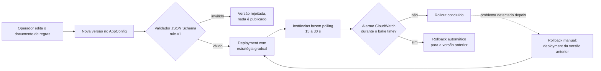
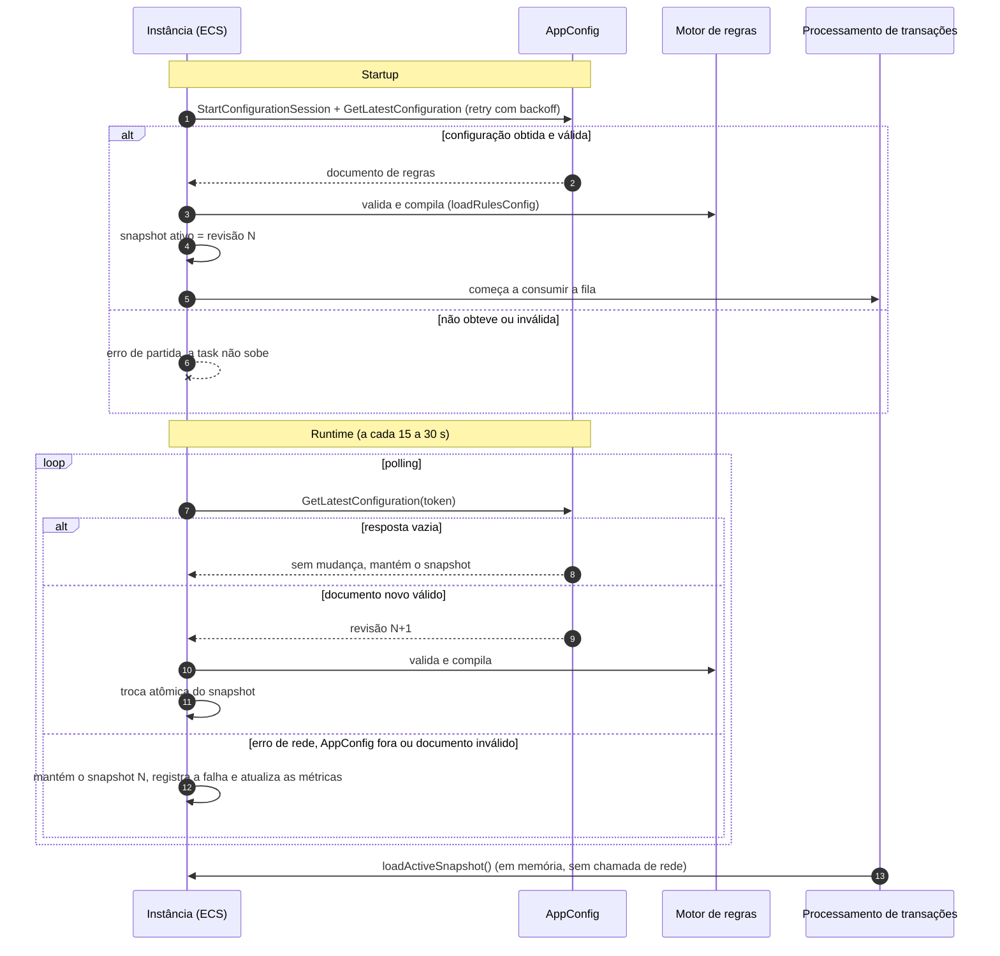
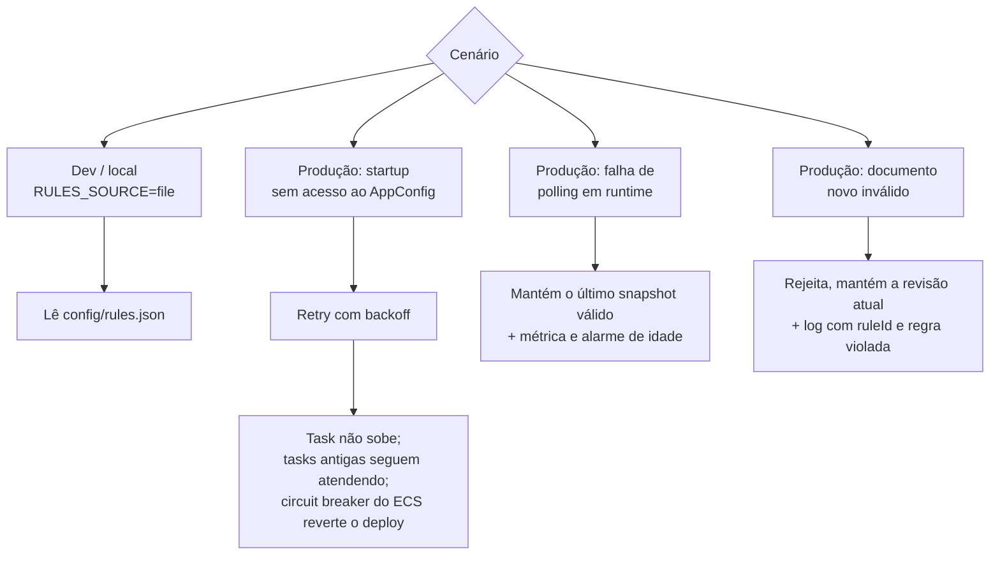

# ADR-03 — Motor de regras

> Status: **proposto**, com a linguagem da expressão **em aberto** · Data: 07/10/2026 (revisado em 10/10/2026: fonte das regras passa a ser o AppConfig; decisões de implementação da feature 002 incorporadas) · Requisitos: RF-10, RF-11, RF-18, RF-20 a RF-23, RF-26, RF-40, RNF-07, RNF-30, RNF-40

## Contexto

As regras precisam ser cadastradas, alteradas e revertidas (*rollback*) **sem redeploy**, como pede o `desafio-tecnico.md` ("extensibilidade das regras sem necessidade de redeploy"). Também precisam ser avaliadas com custo baixo por evento (RNF-07) e não podem executar código arbitrário (RNF-30). O `rule.v1.schema.json` define `expression` como texto, com CEL como alvo.

Hoje as regras são lidas de `config/rules.json` uma única vez, na criação do `RulesModule`, e ficam num snapshot imutável (`StaticRuleRepository`). Mudar uma regra exige rebuild e redeploy, o que contraria o enunciado. Esta revisão corrige isso.

## Decisão

1. **Regras são dados** (`Rule v1`), avaliadas por um interpretador de expressões, **sem `eval`/`Function`**. Cada versão é compilada uma vez e mantida em memória.
2. **Linguagem da expressão: em aberto entre CEL e JSON Logic.** Será decidida com um teste de cerca de 30 min. Critérios:
   - custo por avaliação (meta de trabalho: abaixo de 50 µs por regra típica, a validar);
   - limite de custo e de profundidade verificável na validação (RF-26);
   - qualidade das mensagens de erro;
   - maturidade da biblioteca em Node/TypeScript;
   - impacto no contrato: CEL mantém `expression: string`; JSON Logic exige objeto e muda o `rule.v1`.
3. **Fonte das regras: AWS AppConfig** (*hosted configuration*), atrás da porta de repositório já existente (`loadActiveSnapshot` / `currentRevision`). Cada instância faz *polling* (`GetLatestConfiguration`, a cada 15 a 30 s) e mantém o resultado em memória. O caminho quente da transação **nunca chama o AppConfig**.
4. **Cadastro, alteração e rollback** acontecem no AppConfig:
   - **cadastrar/alterar:** publicar uma nova versão do documento de regras e iniciar um *deployment* com uma estratégia (linear ou canary, com *bake time*);
   - **rollback:** apontar o *deployment* de volta para a versão anterior, ou deixar o AppConfig reverter sozinho quando um alarme do CloudWatch disparar durante o rollout;
   - **validação na publicação:** em três camadas (ver *Decisões de implementação*): pré-validação completa no script de publicação, validador JSON Schema **draft 4** estrutural no perfil e revalidação na instância.
5. **Validação na instância, antes de ativar:** schema, sintaxe, custo e rejeição de `WINDOWED` na fase 1 (RF-18, RF-26), com o mesmo `loadRulesConfig` de hoje, separado do acesso a arquivo. O conjunto novo é compilado e **trocado de uma vez** (troca atômica do snapshot).
6. **Falhas: fail-fast na partida, última versão válida em execução.**
   - **Startup:** a instância tenta obter a configuração com *retry* e *backoff* (cerca de 30 a 60 s). Se não conseguir, **não sobe**, na mesma linha do FR-014b. Não há fallback para o arquivo embutido na imagem em produção.
   - **Runtime:** se o *polling* falhar, o conteúdo for inválido ou o AppConfig estiver fora, a instância **mantém o último snapshot válido** (RF-40), registra o motivo (apenas `ruleId` e regra violada, sem valores) e segue operando.
   - Resposta vazia do `GetLatestConfiguration` significa "sem mudança", nunca "lista vazia de regras". Se a sessão expirar, o cliente reabre com `StartConfigurationSession`.
7. **Visibilidade da defasagem:** manter o último snapshot só é seguro se for possível ver quando ele está velho. Por isso o motor expõe:
   - `rules_active_revision` (por instância);
   - `rules_last_refresh_age_seconds`;
   - `rules_refresh_failures_total`.
   Alarmes: idade do último refresh acima do limite (alinhado ao SLO de *freshness* de 30 s, RNF-40) e instâncias com revisões diferentes por tempo prolongado (rollout travado).
8. **Desenvolvimento local:** `RULES_SOURCE=file` usa o `config/rules.json` e o `StaticRuleRepository`. O arquivo existe **apenas** para dev, testes e docker-compose, e não é lido em produção. Em produção o padrão é `RULES_SOURCE=appconfig`.
9. **`appliesTo`** funciona como pré-filtro barato, antes da expressão.

### Decisões de implementação (feature 002)

Detalhes e justificativas em [specs/002-appconfig-dynamic-rules/research.md](../../specs/002-appconfig-dynamic-rules/research.md).

- **Revisão = rótulo de versão numérico.** A API de dados do AppConfig devolve o `Version-Label`, e não o número da versão. O `scripts/rules/publish-rules.sh` grava como rótulo o carimbo UTC `YYYYMMDDHHMMSS` (inteiro monotônico); conteúdo sem rótulo numérico é rejeitado. Ser inteiro permite alarmar divergência com `MAX − MIN`.
- **Validação em três camadas, sem Lambda.** O validador JSON Schema do AppConfig só aceita o draft 4, e o `rule.v1` usa o 2020-12. (1) O script roda `validateRulesDocument` (a mesma função da instância) antes de criar a versão; (2) o perfil usa um espelho estrutural em draft 4 (`rules-document.v1.draft4.schema.json`), coberto por teste de equivalência no `contracts:validate`; (3) a instância revalida antes de ativar. Um Lambda validador foi descartado por custo de complexidade desproporcional.
- **SDK direto, sem o AppConfig Agent.** O Agent criaria duas camadas de polling, serviria cache de forma opaca (a idade do refresh deixaria de ser observável), dificultaria o fail-fast e adicionaria um contêiner e um endpoint HTTP local sem autenticação. O custo é manter cerca de 100 linhas de cliente (sessão, token de uso único, expiração), cobertas por testes.
- **Timeout em toda chamada** ao AppConfig (padrão 5 s) e *retry* com *backoff* na partida (prazo 45 s); um ciclo de consulta nunca bloqueia o seguinte.
- **Rollback automático por alarme composto.** O AppConfig aceita no máximo 5 monitores por ambiente; um alarme composto (DLQs, idade da fila de transações, falhas de refresh e taxa de alertas) conta como um. Um documento rejeitado pelas instâncias mantém a contagem de falhas enquanto for o último publicado, o que dispara o alarme dentro da janela de rollout e de *bake* e reverte o deployment.
- **Métricas por linha de log.** A aplicação escreve a linha JSON `rules.metrics` a cada 60 s e filtros de métrica no Terraform a transformam em métricas `FraudDetector/Rules`; a extração de EMF pelo `awslogs` não pôde ser confirmada.
- **Rede.** No perfil `full` (sem NAT), o endpoint de VPC `appconfigdata` é necessário; sem ele as tarefas não sobem (fail-fast).
- **Permissões.** A role das tarefas só lê o perfil (`appconfig:StartConfigurationSession` e `appconfig:GetLatestConfiguration` no ARN do perfil); publicar e implantar exige a política/papel `rules-operator`, separado do deploy de código. O CloudTrail registra as ações de gerenciamento.
- **Estratégias.** `rules-gradual` (linear, 10 min, 20%, *bake* de 5 min) como padrão e `rules-immediate` para urgências e reversões.

### Fluxo de cadastro, alteração e rollback

### Ciclo de vida na instância

### Comportamento por cenário

## Alternativas consideradas

| Alternativa | Por que não |
|-------------|-------------|
| Regras no Postgres com contador de revisão e *polling* (decisão anterior deste ADR) | Exige modelar tabela, versionamento, rollback e a ferramenta de cadastro à mão. O AppConfig entrega versões, rollout gradual, rollback e validação prontos, e o ambiente já está na AWS |
| Arquivo embutido como fallback em produção | A imagem fica congelada no build e diverge do AppConfig. Após endurecer uma regra, o fallback voltaria silenciosamente às regras antigas, o pior caso em detecção de fraude. Contraria também o fail-fast do FR-014b |
| Flag de emergência `RULES_FALLBACK_FILE` | Só se justifica se houver um cenário em que subir com regras antigas seja melhor que não subir. Não há hoje; fica como evolução, desligada por padrão e com alerta visível |
| DSL própria | Custo de parser e de segurança sem ganho para o desafio |
| Regras como código | Exige redeploy; contraria o enunciado |

## Consequências

- Mudar **valores e combinações** de regras não exige deploy. Uma regra que precise de campo ou função novos no motor ainda exige.
- A propagação leva até o intervalo de *polling* (15 a 30 s), mais a duração da estratégia de rollout escolhida. O SLO de *freshness* (≤ 30 s, RNF-40) vale para a distribuição final do documento; a estratégia gradual é uma escolha consciente de segurança sobre velocidade e pode ser instantânea (*all at once*) quando for necessário.
- Durante uma queda do AppConfig, instâncias novas não sobem (autoscaling incluído); as existentes seguem com a última versão válida. O risco é aceito para nunca operar com regras erradas ou desatualizadas sem aviso.
- **Limites do AppConfig:** não há fluxo de rascunho e aprovação, nem interface própria de edição. A auditoria é parcial (histórico de versões e deployments, mais CloudTrail), sem registro de quem aprovou. Para o escopo do desafio isso é aceitável.
- **Infraestrutura:** Terraform para `aws_appconfig_application`, `environment`, `configuration_profile` (hosted, com validador JSON Schema), `deployment_strategy` e `deployment`, mais permissão `appconfig:StartConfigurationSession` e `appconfig:GetLatestConfiguration` na role da task, e alarmes novos em `monitoring.tf`.
- **Código:** novo `AppConfigRuleRepository` com a interface do `StaticRuleRepository`; `loadRulesConfig` passa a receber o conteúdo em vez de ler o arquivo; o `RulesModule` escolhe a fonte por `RULES_SOURCE`.
- O motor de avaliação é igual no ambiente local e na AWS; só a fonte muda.

## Gatilhos de revisão

Resultado do teste de linguagem; necessidade de fluxo de aprovação e auditoria completa (avaliar uma camada de gestão sobre o AppConfig, com Postgres para rascunho e trilha); cenário real que justifique a flag de fallback; regras de janela mais complexas (função `distanceKm`, agregação `LAST`).
