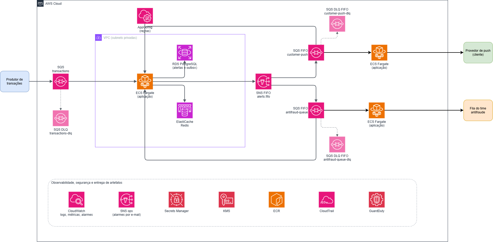
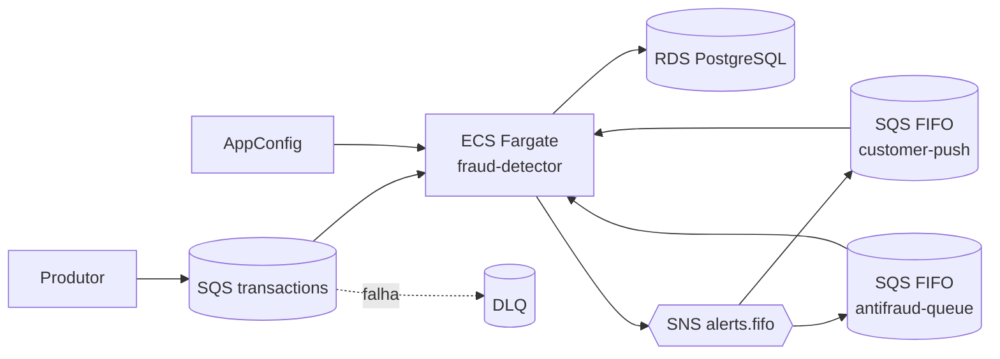

# Elementos da arquitetura na AWS

Catálogo dos componentes AWS que compõem a solução, com o papel de cada um e os parâmetros que importam. O comportamento passo a passo está em [fluxo-processamento.md](fluxo-processamento.md); aqui o foco é **o que existe na infraestrutura**. A fonte é o Terraform em `infra/terraform/envs/production` (perfis `lean.tfvars` e `full.tfvars`).

## Desenho

[Abrir no diagrams.net](https://viewer.diagrams.net/?tags=%7B%7D&lightbox=1&highlight=0000ff&edit=_blank&layers=1&nav=1&title=arquitetura-aws.drawio&dark=auto#Uhttps%3A%2F%2Fdrive.google.com%2Fuc%3Fid%3D1gMnbTtdFDXP4fsqiSHayc5DcPd36oPl1%26export%3Ddownload) · [arquivo `.drawio`](diagramas/arquitetura-aws.drawio)

O desenho mostra só os elementos principais. NAT Gateway, Internet Gateway, subnets, security groups, IAM e VPC endpoints não aparecem; estão descritos [mais abaixo](#rede).

## Sumário

1. [Visão geral](#visão-geral)
2. [Entrada](#entrada)
3. [Processamento](#processamento)
4. [Regras](#regras)
5. [Saída e canais](#saída-e-canais)
6. [Rede](#rede)
7. [Observabilidade](#observabilidade)
8. [Segurança](#segurança)
9. [Perfis `lean` e `full`](#perfis-lean-e-full)
10. [Lacunas conhecidas](#lacunas-conhecidas)

---

## Visão geral

| Camada | Serviço AWS | Elemento | Papel |
|---|---|---|---|
| Entrada | SQS (standard) | `transactions`, `transactions-dlq` | Recebe as transações e isola as inválidas |
| Processamento | ECS Fargate | serviço `fraud-detector` | Consome, valida, avalia regras, grava e publica |
| Persistência | RDS PostgreSQL 16 | banco `fraud` | Alertas, outbox e entregas |
| Cache | ElastiCache Redis 7.1 | grupo de replicação | Provisionado; **sem uso pelo código de negócio** |
| Regras | AppConfig | aplicação `fraud-rules` | Regras declarativas sem redeploy |
| Fan-out | SNS FIFO | `alerts.fifo` | Distribui o alerta aos canais |
| Canais | SQS FIFO | `alert-deliveries-customer-push`, `alert-deliveries-antifraud-queue` e as DLQs | Uma fila por canal |
| Operação | CloudWatch, SNS standard | logs, métricas, alarmes, dashboard, tópico `ops` | Observabilidade e alerta operacional |
| Segurança | KMS, Secrets Manager, CloudTrail, GuardDuty, IAM | | Criptografia, segredos, auditoria e permissões |
| Artefatos | ECR | repositório da aplicação | Imagem do serviço |

---

## Entrada

| Elemento | Tipo | Parâmetros | Observação |
|---|---|---|---|
| `transactions` | SQS standard | `visibility_timeout` de 10 s; `maxReceiveCount` de 10 para a DLQ; criptografia em repouso | O timeout de 10 s é acoplado ao código (retentativas com `ChangeMessageVisibility`): não alterar sem revisar o consumidor |
| `transactions-dlq` | SQS standard | retenção de 14 dias | Recebe o que esgotou as retentativas. A rejeição por validação é escrita pela aplicação (`DlqMessage`) |
| Política da fila | `aws_sqs_queue_policy` | O envio por outras contas é liberado pela variável `transaction_producer_principals` | Lista vazia por padrão |

---

## Processamento

### ECS Fargate

| Parâmetro | `lean` | `full` |
|---|---|---|
| CPU / memória por task | 1 vCPU / 2 GB | 1 vCPU / 2 GB |
| Tasks (desejado, mín., máx.) | 3, 3, 6 | 8, 8, 20 |
| Capacity provider | FARGATE_SPOT (peso 1) | FARGATE base 4 + peso 1, e SPOT peso 1 |
| Autoscaling | CPU alvo de 60%; scale-out com cooldown de 60 s; scale-in com cooldown de 300 s | idem |
| Container Insights | ligado | ligado |

- **Um serviço, vários papéis.** O mesmo serviço consome `transactions`, avalia as regras, grava alerta + outbox, publica no SNS, roda o relay do outbox e consome as filas de canal para entregar. Os *pollers* são configuráveis (`sqs_transaction_pollers`, padrão 4; `sqs_channel_pollers`, padrão 2).
- **Migrações** rodam numa task separada (`migrate`, 0,25 vCPU / 512 MB), fora do serviço.
- **Segredos** (`DATABASE_URL`, `REDIS_URL`) vêm do Secrets Manager, não de variável de ambiente em texto.
- Nos testes de carga o serviço rodou **On-Demand** (override `loadtest.tfvars`) para uma reclamação de Spot não invalidar a janela; ver [teste de 4.000 TPS](teste-de-carga-aws-4000tps.md).

### RDS PostgreSQL

| Parâmetro | `lean` | `full` |
|---|---|---|
| Classe | `db.t4g.medium` | `db.m6g.xlarge` |
| Multi-AZ | não | sim |
| Retenção de backup | 7 dias | 14 dias |
| Proteção contra exclusão | não | sim |
| Performance Insights | não | sim |

- Engine PostgreSQL 16, armazenamento gp3 criptografado, 50 GB com autoscaling de armazenamento até 4×.
- Parâmetro `rds.force_ssl` ativo (grupo de parâmetros `fraud-detector-pg16`).
- Guarda `alerts`, `outbox` e `deliveries`; modelo em [modelo-de-dados.md](modelo-de-dados.md).

### ElastiCache Redis

| Parâmetro | `lean` | `full` |
|---|---|---|
| Nó | `cache.t4g.micro` | `cache.t4g.small` |
| Nós | 1 | 2 (Multi-AZ) |

Engine 7.1. **O Redis está provisionado e conectado, mas nenhum código de negócio o usa**: ele foi reservado para o estado de janela da regra de velocidade, que foi cortada ([ADR-02](adr/ADR-02-dedupe-e-estado-de-janela.md)). Só o `/health/ready` faz `PING`, de forma informativa; uma queda dele não derruba o serviço.

---

## Regras

| Elemento | Parâmetros |
|---|---|
| AppConfig: aplicação `fraud-rules`, ambiente `production` | Perfil de configuração hospedado, com validador JSON Schema (draft 4) |
| Estratégia `fraud-detector-rules-gradual` | 10 min, crescimento linear de 20% por passo, 5 min de bake |
| Estratégia `fraud-detector-rules-immediate` | 0 min, 100%, sem bake |
| Alarme composto `fraud-detector-rules-rollback` | Monitor do ambiente: reverte o deployment automaticamente |
| Papel `rules_operator` | Quem pode publicar regras |

As instâncias consultam o AppConfig e trocam o conjunto de regras de forma atômica, sem reinício. Detalhes de operação em [ADR-03](adr/ADR-03-motor-de-regras.md).

---

## Saída e canais

| Elemento | Tipo | Parâmetros |
|---|---|---|
| `alerts.fifo` | SNS FIFO | `content_based_deduplication` desligado (usa o `dedupeKey`); throughput por *message group* |
| `alert-deliveries-customer-push.fifo` | SQS FIFO | `visibility_timeout` de 30 s; deduplicação e limite por *message group* |
| `alert-deliveries-antifraud-queue.fifo` | SQS FIFO | idem |
| `…-dlq.fifo` (uma por canal) | SQS FIFO | retenção de 14 dias; **sem redrive nativo**: a aplicação escreve a `DlqMessage` |
| Assinaturas | SNS → SQS | Uma por canal; a política da fila só aceita entregas do tópico `alerts.fifo` |

Os provedores de entrega (push ao cliente e fila do time antifraude) são **externos à AWS**; no ambiente de teste são simulados. A degradação entre canais está em [degradacao-de-canais.md](degradacao-de-canais.md).

---

## Rede

| Elemento | Detalhe |
|---|---|
| VPC | `10.0.0.0/16`, 2 zonas de disponibilidade |
| Subnets | 2 públicas, 2 privadas e 2 isoladas (ECS nas privadas; dados nas isoladas) |
| Saída para a internet | **`lean`**: NAT Gateway, sem VPC endpoints. **`full`**: sem NAT, com VPC endpoints |
| VPC endpoints (`full`) | Interface: `sqs`, `sns`, `ecr.api`, `ecr.dkr`, `logs`, `secretsmanager`, `appconfigdata`; mais `kms` (interface, só com CMK) e `s3` (gateway) |
| Security groups | `app`, `rds`, `redis` e `vpce`, com regras mínimas entre eles |
| VPC Flow Logs | `REJECT` no `lean`, `ALL` no `full` |

> No `lean`, o ECS chega ao SQS, SNS e AppConfig **pelo NAT Gateway**; os endpoints de VPC só existem no `full`.

---

## Observabilidade

| Elemento | Detalhe |
|---|---|
| CloudWatch Logs | Grupos `/ecs/fraud-detector`, `…-migrate`, `…-loadtest` e de Flow Logs; retenção de 14 dias (`lean`) ou 90 (`full`) |
| Métricas | Filtros de log geram métricas de pipeline, regras e latência de alerta (namespaces `FraudDetector/Pipeline` e `FraudDetector/Rules`) |
| Dashboard | `fraud-detector-operacao` |
| SNS `ops` | Recebe os alarmes e envia por e-mail (`alert_email`) |
| Budget | Orçamento mensal (US$ 150 no `lean`, 800 no `full`) com alarme |

Alarmes: DLQs não vazias, idade da mensagem mais antiga em `transactions`, latência p99 do alerta acima do SLO de 500 ms, outbox pendente há mais de 30 s, CPU do ECS e do RDS, armazenamento livre do RDS, tasks abaixo do desejado e os alarmes de regras (refresh obsoleto, revisão divergente por 20 min, falhas de refresh e anomalia na taxa de alertas). SLOs em [ADR-08](adr/ADR-08-observabilidade-e-slos.md).

---

## Segurança

| Elemento | Detalhe |
|---|---|
| KMS | Chave gerenciada pelo cliente só no `full` (`enable_cmk`); no `lean`, SQS e SNS usam a criptografia gerenciada pela AWS |
| Secrets Manager | `fraud/prod/database-url` e `fraud/prod/redis-url` |
| IAM | Papéis separados: aplicação, execução do ECS, migração, operador de regras, monitores do AppConfig, Flow Logs e teste de carga |
| CloudTrail | Ligado nos dois perfis; bucket S3 próprio com acesso público bloqueado, criptografia e ciclo de vida |
| GuardDuty | Só no `full` |
| Estado do Terraform | Bucket S3 com versionamento e criptografia (`bootstrap`) |

Modelo de autenticação, LGPD e lacunas em [ADR-07](adr/ADR-07-seguranca-autenticacao-e-lgpd.md).

---

## Perfis `lean` e `full`

| Aspecto | `lean` | `full` |
|---|---|---|
| Objetivo | Menor custo, para os testes de carga | Desenho de produção |
| Banco | `db.t4g.medium`, 1 AZ | `db.m6g.xlarge`, Multi-AZ |
| Redis | 1 nó `micro` | 2 nós `small` |
| ECS | 3 a 6 tasks, Spot | 8 a 20 tasks, base On-Demand |
| Rede | NAT, sem endpoints | Endpoints, sem NAT |
| Criptografia | gerenciada pela AWS | chave KMS do cliente |
| GuardDuty | desligado | ligado |
| `ephemeral` | sim (ambiente descartável) | não |

Todos os testes de carga e de regras foram executados no perfil **`lean`**. O `full` está descrito no Terraform, mas **não foi aplicado nem medido**.

---

## Lacunas conhecidas

- **Redis sem uso** (ver acima): custo e superfície sem benefício até a regra de janela voltar.
- **Perfil `full` não validado** em carga.
- **Sem gateway de entrada**: os produtores escrevem direto no SQS, e o controle de acesso é o do IAM sobre a fila (o desenho não inclui API Gateway).
- **Os canais externos são simulados** nos testes.
