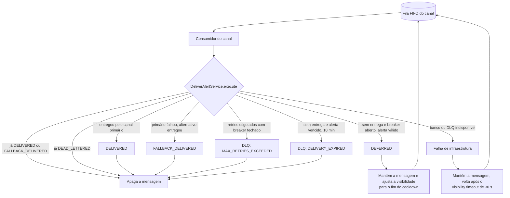
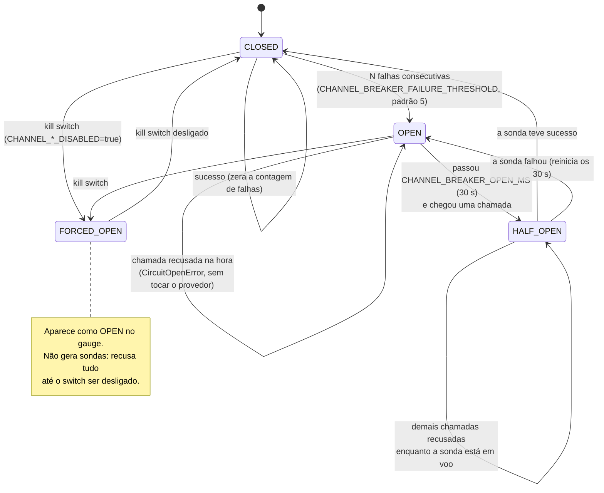
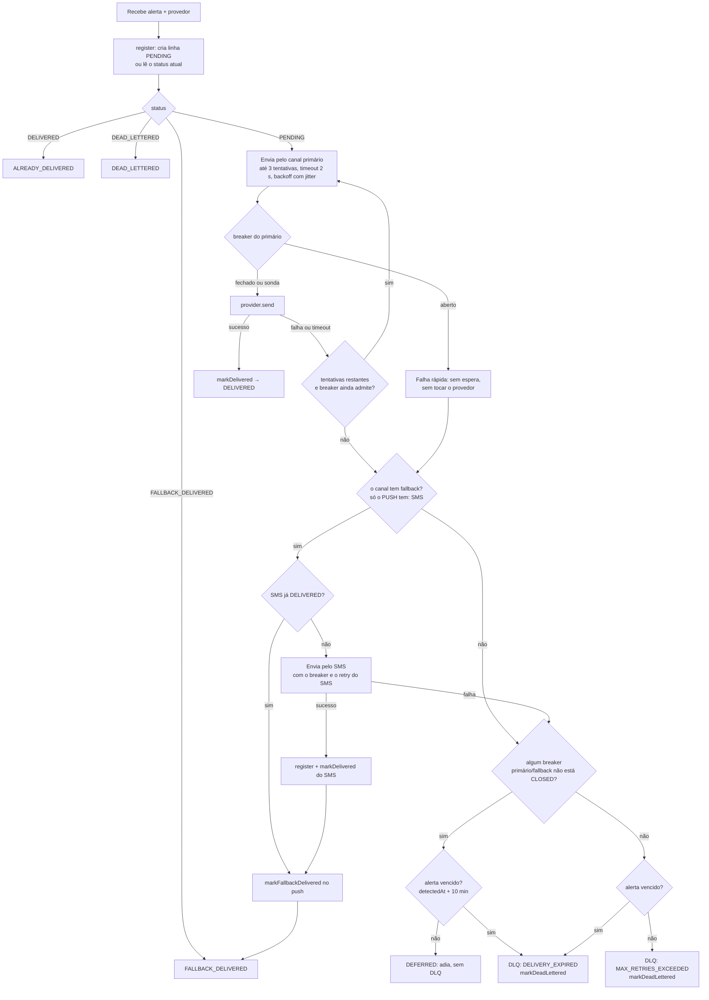
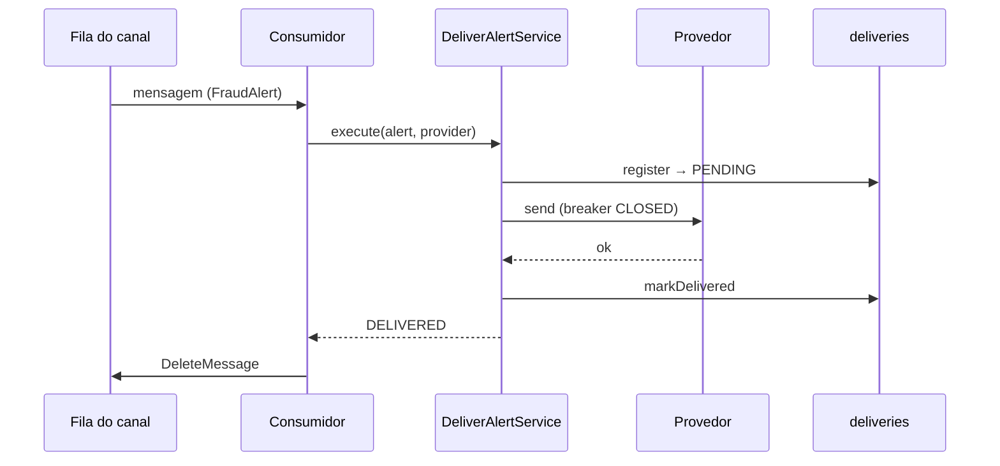
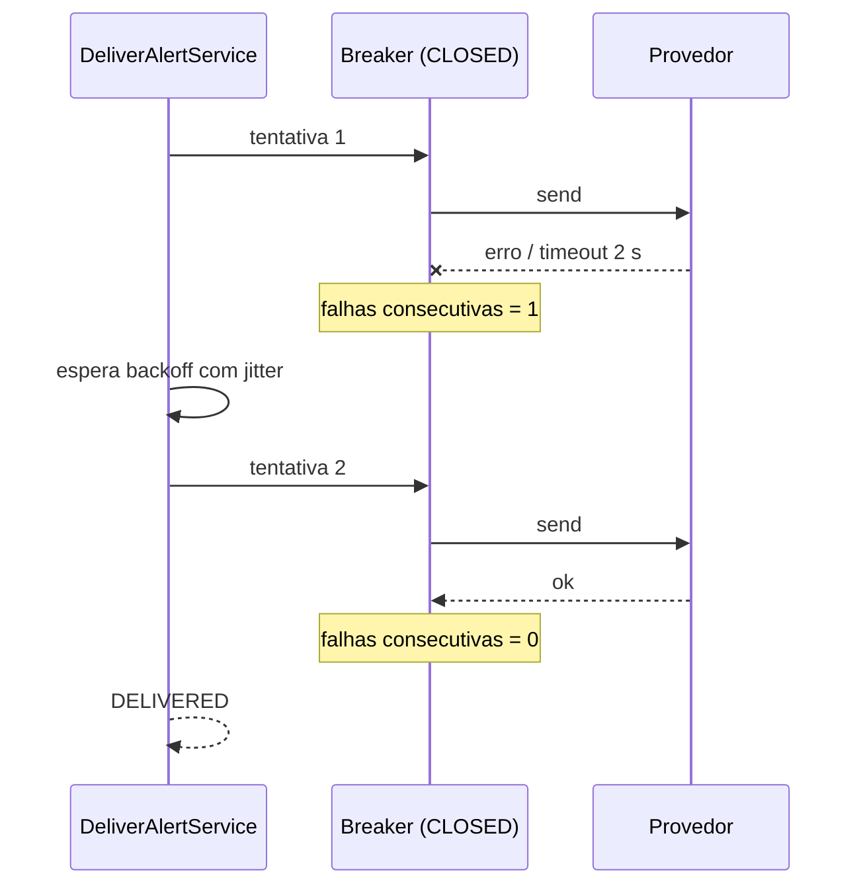
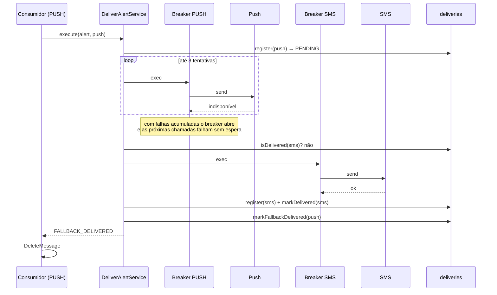
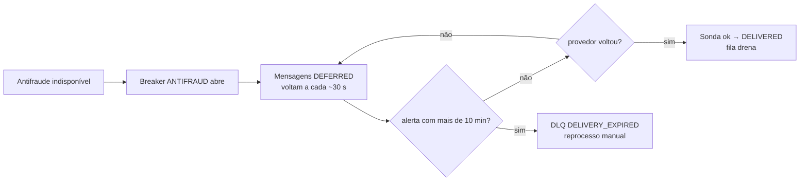
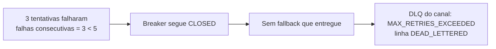
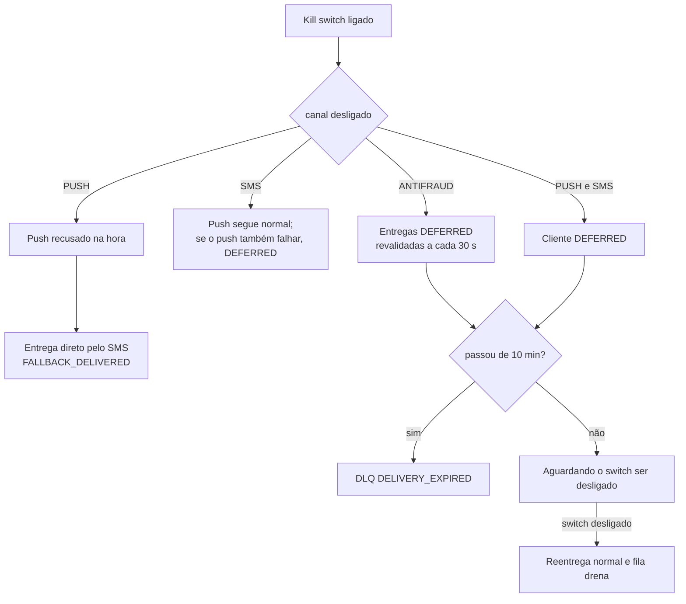
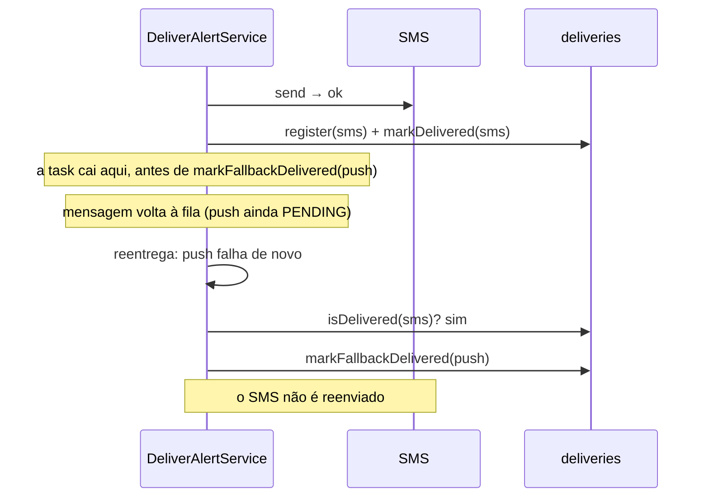

# Degradação na entrega de alertas: circuit breaker, fallback e adiamento

Como a entrega de alertas se comporta quando um canal falha. Decisão e justificativas: [ADR-05](adr/ADR-05-estrategia-de-degradacao.md#adendo-2026-10-12-circuit-breaker-fallback-de-canal-e-kill-switch-implementados). Código: `src/deliveries/deliver-alert.service.ts`, `src/deliveries/sqs-channel.consumer.ts`, `src/shared/circuit-breaker.ts`. Fluxo geral do pipeline: [fluxo-processamento.md](fluxo-processamento.md).

**Premissa central:** a detecção e a geração do alerta nunca dependem da entrega. Tudo abaixo acontece depois que o alerta já está gravado (Postgres + outbox) e publicado; uma falha de canal só afeta a entrega daquele canal.

## 1. Visão geral: o que acontece com uma mensagem de entrega



| Resultado | Quem apaga a mensagem | Vai à DLQ? | Linha em `deliveries` |
|---|---|---|---|
| `DELIVERED` | consumidor | não | `DELIVERED` |
| `FALLBACK_DELIVERED` | consumidor | não | push `FALLBACK_DELIVERED`, SMS `DELIVERED` |
| `DEFERRED` | ninguém (volta à fila) | não | `PENDING` |
| `DEAD_LETTERED` | consumidor | sim | `DEAD_LETTERED` |
| falha de infraestrutura | ninguém (volta à fila) | não | inalterada |

## 2. Máquina de estados do circuit breaker

Um breaker por canal (`ANTIFRAUD_QUEUE`, `PUSH`, `SMS`), com estado em memória, por task.



Valores do gauge `circuit_breaker_state{channel}`: `0` fechado, `1` meio-aberto, `2` aberto (inclui o kill switch).

## 3. Decisão por entrega (dentro do `execute`)



## 4. Cenários

### Resumo

| # | Cenário | Canal | Resultado | DLQ? | Visível em |
|---|---|---|---|---|---|
| A | Tudo saudável | todos | `DELIVERED` | não | `DeliveriesDelivered` |
| B | Falha transitória do provedor | qualquer | `DELIVERED` após retry | não | tentativas em `deliveries.attempts` |
| C | Push fora, SMS saudável | cliente | `FALLBACK_DELIVERED` | não | `DeliveriesFallback`, `BreakerPush` = 2 |
| D | Push e SMS fora, breaker abre | cliente | `DEFERRED`, depois `DELIVERED` | não | `DeliveriesDeferred`, `BreakerPush/Sms` = 2 |
| E | Antifraude fora | interno | `DEFERRED`; se passar de 10 min, DLQ `DELIVERY_EXPIRED` | só se vencer | `BreakerAntifraud` = 2, `DeliveriesDeferred` |
| F | Retries esgotados com breaker ainda fechado | qualquer | `DEAD_LETTERED` (`MAX_RETRIES_EXCEEDED`) | sim | `DeliveriesDeadLettered`, `DlqMessages` |
| G | Kill switch ligado | qualquer | push → SMS; os demais `DEFERRED` | só se vencer | gauge em 2 sem falhas |
| H | Banco ou DLQ indisponível durante a entrega | qualquer | mensagem volta à fila | não | `DeliveriesInfraFailure` |
| I | Queda entre enviar o SMS e marcar o push | cliente | reentrega sem duplicar o SMS | não | `FALLBACK_DELIVERED` |
| J | Recuperação com mensagens acumuladas | qualquer | drena pela sonda | não | breaker volta a 0 |

### A. Tudo saudável



### B. Falha transitória do provedor

Uma ou duas falhas seguidas são absorvidas pelo retry; o breaker só abre com falhas **consecutivas** acima do limiar, e um sucesso zera a contagem.



### C. Push fora, SMS saudável (fallback)



- O SMS usa `deliveryId = sha256("alert-delivery:v1:" + alertId + ":SMS")`, com o mesmo conteúdo mínimo do push (tipo, valor, data, orientação), sem PII adicional.
- Com o breaker do push **aberto**, cada novo alerta pula o push na hora (sem os ~2 s de timeout × 3) e vai direto ao SMS.
- A linha do SMS só é criada quando ele entrega, para não deixar entrega `PENDING` órfã.

### D. Push e SMS fora: adiamento e recuperação

```mermaid
sequenceDiagram
    participant Q as Fila do push
    participant C as Consumidor
    participant S as DeliverAlertService
    participant BP as Breaker PUSH
    participant BS as Breaker SMS
    Q->>C: mensagem
    C->>S: execute
    S->>BP: tentativas falham → breaker OPEN
    S->>BS: SMS falha → breaker OPEN
    S-->>C: DEFERRED (alerta ainda válido)
    C->>Q: ChangeMessageVisibility = tempo até reabrir (1 a 300 s)
    Note over Q,C: sem DLQ; a mensagem não é apagada
    Note over BP: após 30 s: HALF_OPEN
    Q->>C: mensagem reaparece
    C->>S: execute
    S->>BP: sonda
    alt provedor voltou
        BP-->>S: sucesso → CLOSED
        S-->>C: DELIVERED
        C->>Q: DeleteMessage
    else ainda fora
        BP-->>S: falha → OPEN por mais 30 s
        S-->>C: DEFERRED de novo
    end
```

Enquanto durar a queda, o ciclo se repete a cada ~30 s por mensagem. Na recuperação, a fila drena sem redrive manual e sem passar pela DLQ.

### E. Antifraude fora (sem fallback)

O contrato proíbe cliente em canal interno e vice-versa, então o canal antifraude não tem alternativa: só adia.



Os canais do cliente seguem normalmente: cada canal tem fila, consumidor e breaker próprios (bulkhead).

### F. Retries esgotados com o breaker ainda fechado

Ocorre quando as tentativas de **um** alerta acabam antes do limiar de falhas consecutivas (padrão: 3 tentativas contra limiar 5). É tratado como falha daquele alerta, não do canal inteiro:



Consequência assumida: o **primeiro** alerta de uma queda pode ir à DLQ; a partir do seguinte as falhas acumuladas abrem o breaker e as mensagens passam a ser adiadas.

### G. Kill switch

`CHANNEL_ANTIFRAUD_DISABLED`, `CHANNEL_CUSTOMER_DISABLED` ou `CHANNEL_SMS_DISABLED` = `true` força o breaker do canal aberto, sem falha prévia.



Na AWS é variável do serviço ECS: muda-se o valor no `ecs.tf` e roda-se `terraform apply` (rolling update de ~2 min, sem build nem deploy de código). Não há sondas enquanto o switch está ligado.

### H. Falha de infraestrutura (Postgres ou DLQ)

Se o Postgres, o registro da entrega ou a publicação na DLQ falham, `execute` lança. O consumidor não apaga a mensagem; ela volta após o visibility timeout (30 s) e é reprocessada de forma idempotente (`deliveryId` estável + `register` com `ON CONFLICT DO NOTHING`). Conta em `DeliveriesInfraFailure`; o alarme de DLQ não dispara, mas o de idade da fila do canal sim, se persistir.

### I. Queda entre enviar o SMS e marcar o push



Janela residual: se a queda ocorrer **depois** do SMS e o push voltar a funcionar na reentrega, o cliente pode receber push e SMS. É preferível ao risco oposto (não notificar).

### J. Recuperação com acúmulo

Com N mensagens adiadas, cada uma volta à fila no fim do próprio cooldown. A primeira que chega ao breaker meio-aberto vira a **sonda**; as demais, enquanto a sonda está em voo, são recusadas e adiadas por ~1 s. Com a sonda bem-sucedida, o breaker fecha e a fila drena na velocidade normal do consumidor. Ordem por conta (grupo FIFO) preservada: uma mensagem adiada segura as seguintes do mesmo grupo.

## 5. Como observar

| Sinal | Onde | Leitura |
|---|---|---|
| `circuit_breaker_state{channel}` | `/metrics`, `BreakerAntifraud/Push/Sms` no CloudWatch | 0 fechado, 1 meio-aberto, 2 aberto ou kill switch |
| `circuit_breaker_transitions_total{channel,to}` | `/metrics`, logs `circuit breaker do canal mudou de estado` | frequência de abertura/fechamento |
| `deliveries_total{status="fallback"}` | `DeliveriesFallback` | alertas que saíram pelo SMS |
| `deliveries_total{status="deferred"}` | `DeliveriesDeferred` | entregas adiadas por breaker aberto |
| `deliveries_total{status="dead_lettered"}`, `dlq_total` | `DeliveriesDeadLettered`, `DlqMessages`, alarme de DLQ | o que exige reprocesso |
| idade da fila do canal | `AWS/SQS ApproximateAgeOfOldestMessage` | acúmulo durante a queda |

Dashboard `<nome>-operacao`: widgets *Circuit breaker por canal* e *Fallback e entregas adiadas* (linha 6).

## 6. Parâmetros

| Variável | Padrão | Efeito |
|---|---|---|
| `CHANNEL_DELIVERY_MAX_ATTEMPTS` | 3 | tentativas por entrega, por canal |
| `CHANNEL_DELIVERY_BASE_DELAY_MS` / `_MAX_DELAY_MS` | 200 / 2000 | backoff exponencial com jitter total |
| `CHANNEL_SEND_TIMEOUT_MS` | 2000 | limite por tentativa |
| `CHANNEL_BREAKER_FAILURE_THRESHOLD` | 5 | falhas consecutivas que abrem o breaker |
| `CHANNEL_BREAKER_OPEN_MS` | 30000 | tempo aberto antes da sonda |
| `CHANNEL_*_DISABLED` | `false` | kill switch do canal |
| `CHANNEL_*_FAIL` | `false` | injeção de falha no provedor simulado (demonstração e testes) |
| validade do alerta | 10 min | `detectedAt` + `DELIVERY_TTL_MS`; passado disso, DLQ `DELIVERY_EXPIRED` |

## 7. Limites assumidos

- **Estado por task:** cada instância aprende sozinha; no pior caso, 3 tasks × 5 falhas até todas abrirem. Estado compartilhado (Redis) é evolução.
- **Kill switch não é instantâneo:** exige rolling update do serviço. Corte imediato exigiria um perfil de feature flag no AppConfig.
- **Alerta vencido vai à DLQ:** queda do antifraude por mais de 10 min leva os alertas à DLQ para reprocesso manual.
- **Primeiro alerta de uma queda:** pode ir à DLQ antes de o breaker abrir (cenário F).
- **Fallback só push → SMS:** não há e-mail nem outra alternativa para o canal interno.
