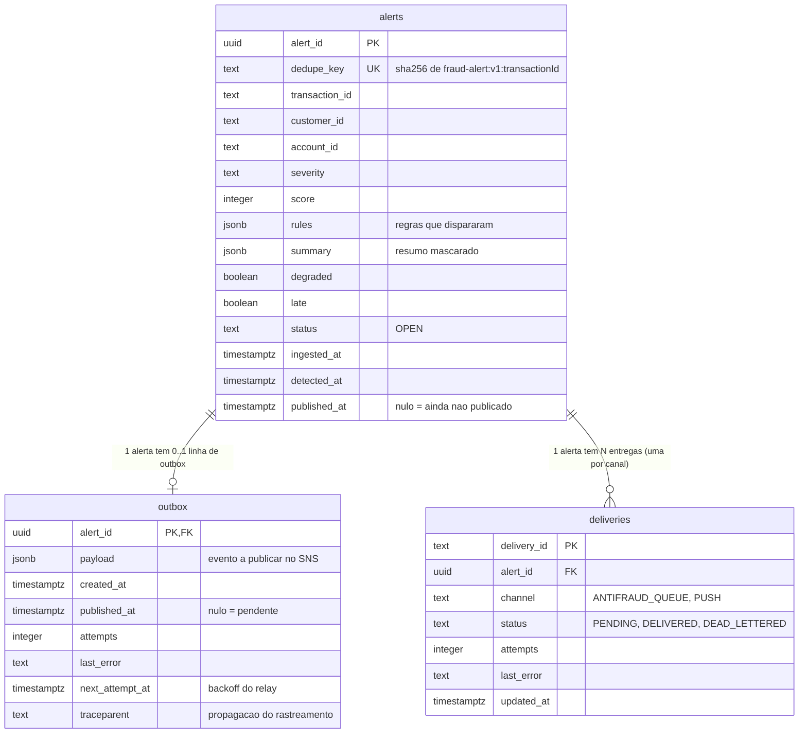

# Modelo de dados (PostgreSQL)

Diagrama entidade-relacionamento das tabelas do Postgres, derivado das migrações em [`src/database/migrations/`](../src/database/migrations/) (`001_init.sql`, `002_outbox_relay.sql` e `003_drop_rules_tables.sql`). Decisão de armazenamento: [ADR-04](adr/ADR-04-armazenamento.md). Descrição por campo e regras de consistência do *outbox*: [`specs/001-transaction-fraud-detection/data-model.md`](../specs/001-transaction-fraud-detection/data-model.md).

## Diagrama

## Tabelas em uso

| Tabela | Papel | Escrita por | Índices |
|---|---|---|---|
| `alerts` | Um alerta por transação suspeita; `dedupe_key` UNIQUE garante a idempotência | `AlertRepository.saveWithOutbox` (`INSERT … ON CONFLICT (dedupe_key) DO NOTHING`) | `alerts_transaction_idx (transaction_id)`, `alerts_status_idx (status, detected_at)` |
| `outbox` | Fila transacional de publicação; gravada **na mesma transação** do alerta | `AlertRepository`; atualizada pela publicação inline e pelo relay (`FOR UPDATE SKIP LOCKED`) | `outbox_pending_idx (next_attempt_at) WHERE published_at IS NULL` |
| `deliveries` | Estado da entrega do alerta em cada canal | `DeliveryRepository` (`register`, entrega confirmada, DLQ do canal) | `deliveries_alert_idx (alert_id)` |

Fluxo de escrita: alerta + outbox numa transação → publicação no SNS → `published_at` preenchido no outbox e no alerta → consumidores de canal registram e atualizam `deliveries`. Ver [fluxo de processamento](fluxo-processamento.md).

## Tabelas da migração sem uso

A migração `001_init.sql` ainda cria `audit_log` e `routing_policy`, mas **nenhum código da aplicação as lê ou escreve**; por isso não aparecem no diagrama. As regras de detecção não ficam no banco: vêm do AWS AppConfig em produção e de `config/rules.json` em desenvolvimento ([ADR-03](adr/ADR-03-motor-de-regras.md)), e a auditoria das mudanças de regra fica no AppConfig e no CloudTrail. As tabelas `rule_versions` e `rules_revision`, criadas na `001`, foram removidas pela `003` quando as regras saíram do banco.
