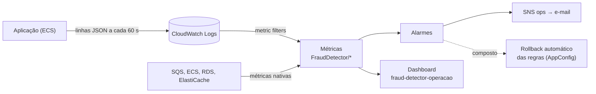

# Observabilidade

Como saber se o detector de fraude está saudável, e o que fazer quando não está. Esta seção explica o que foi criado no CloudWatch: as **métricas** que alimentam tudo, os **alarmes** que avisam e o **dashboard** que mostra. As decisões por trás (instrumentação, SLOs, resposta a incidentes) estão no [ADR-08](../adr/ADR-08-observabilidade-e-slos.md).

| Página | Pergunta que responde |
|---|---|
| [Métricas](metricas.md) | O que é medido, de onde vem e o que cada número quer dizer? |
| [Alarmes](alarmes.md) | Quando alguém é avisado, por quê, e onde olhar primeiro? |
| [Dashboard](dashboard.md) | O que cada painel mostra e como lê-lo? |

## Como as peças se encaixam

1. A aplicação escreve **linhas de log JSON** com contadores e gauges. Não há agente nem sidecar.
2. **Filtros de métrica** do CloudWatch transformam essas linhas em métricas nos namespaces `FraudDetector/Pipeline` e `FraudDetector/Rules`.
3. As métricas nativas da AWS (SQS, ECS, RDS, ElastiCache) completam o quadro.
4. **Alarmes** e **dashboard** leem tudo isso. Os alarmes publicam no tópico SNS `fraud-detector-ops-alerts`, com assinatura por e-mail.

## Os três sinais mais importantes

Se só der para olhar três coisas, olhe estas:

| Sinal | Saudável | Por quê |
|---|---|---|
| **Latência do alerta p99** | abaixo de 500 ms | É o SLO do enunciado |
| **Idade da mensagem mais antiga em `transactions`** | perto de 0 s | Se cresce, o consumo não acompanha a entrada |
| **Mensagens nas DLQs** | 0 | Qualquer valor é uma falha que ninguém tratou |

## O que ainda não existe

Registrado no ADR-08 e confirmado na infraestrutura:

- alertas por *burn rate* e *runbooks*;
- tracing distribuído (o rastreio é por `traceId` nos logs);
- SLO de disponibilidade mensal (RNF-10): só há os componentes (backlog, DLQ, tasks);
- alarme de *circuit breaker* aberto: o estado aparece no dashboard, mas não alerta.
