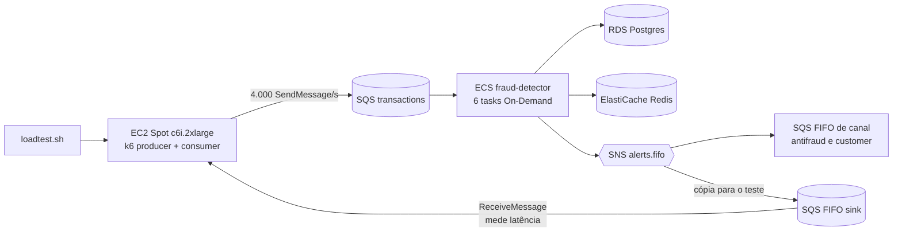

# Teste de carga na AWS: 4.000 TPS

> Status: **executado e aprovado em 13/10/2026** (C1 a C11 e G1). Este documento registra o **resultado** do degrau de 4.000 TPS. O procedimento, o perfil de carga e os critérios de aceite são os do [teste de 1.000 TPS](teste-de-carga-aws-1000tps.md); o gerador em EC2 está em [teste-de-carga-aws-runner-ec2.md](teste-de-carga-aws-runner-ec2.md). O resumo de todas as execuções fica em [registro-testes-aws.md](registro-testes-aws.md).

## Sumário

1. [Veredito](#1-veredito)
2. [Configuração da execução](#2-configuração-da-execução)
3. [Critérios de aceite](#3-critérios-de-aceite)
4. [Latência](#4-latência)
5. [Recursos](#5-recursos)
6. [Comparação com 1.000 TPS](#6-comparação-com-1000-tps)
7. [O que o resultado mostra](#7-o-que-o-resultado-mostra)
8. [Ressalvas e pontos em aberto](#8-ressalvas-e-pontos-em-aberto)
9. [Próximo degrau](#9-próximo-degrau)

---

## 1. Veredito

**APROVADO.** Todos os critérios passaram, sem descartes, sem erros de envio, sem perda nem duplicação de alertas e com as DLQs vazias. A latência de serviço ficou em **p95 de 90 ms e p99 de 174 ms** (limite de 500 ms), com a CPU do ECS em 49,6% e a do RDS em 15,9%.

| Pergunta do teste | Resposta |
|---|---|
| O gerador entregou 4.000 TPS? | Sim: 1.388.978 de 1.389.000 eventos planejados, 0 descartados |
| Alguma perda ou duplicata? | Não: 13.905 de 13.905 alertas recebidos, 0 duplicados |
| O alerta ficou em até 500 ms? | Sim: p99 de 174 ms (serviço) e 207 ms (e2e) |
| A fila acumulou? | Não: idade da mensagem mais antiga em 0 s |
| Algum componente saturou? | Não: ECS a 49,6%, RDS a 15,9%, gerador a 58,3% |

---

## 2. Configuração da execução

| Item | Valor |
|---|---|
| Data (UTC) | 2026-10-13, execução de 05:05:54 a 05:13:36 |
| Janela de medição (steady) | 05:07:24 a 05:12:24 (5 min) |
| Perfil | `lean` |
| Aplicação | imagem `6d61ae3-dirty20261012204531` |
| Serviço ECS | 6 tasks Fargate On-Demand |
| Gerador | 1 instância EC2 Spot `c6i.2xlarge` (8 vCPU), k6 `615afd484b3f` |
| Carga | 90 s de aquecimento, 4.000 TPS por 300 s, 60 s de drain |
| Taxa de alertas | 1% |
| Relatório | `load/k6/results/20261013T050554Z-aws-main-3b8ac3cc*` |

Um smoke de 50 TPS (20% de alertas) rodou antes da carga principal: 3.000 de 3.000 eventos, 603 alertas recebidos de 603 esperados, 0 duplicados, p99 de serviço de 78,9 ms.

---

## 3. Critérios de aceite

| # | Critério | Limite | Medido | Status |
|---|---|---|---|---|
| C1 | Taxa de envio efetiva | ≥ 99% do planejado e 0 descartadas | 1.388.978 de 1.389.000 (100,0%), 0 descartadas | ok |
| C2 | Erros de envio | < 0,1% | 0,000% | ok |
| C3 | Alertas recebidos ÷ esperados | = 100% | 13.905 de 13.905 | ok |
| C4 | Alertas duplicados | = 0 | 0 | ok |
| C5 | Latência de serviço p95 | < 500 ms | 90 ms | ok |
| C6 | Latência de serviço p99 | < 500 ms | 174 ms | ok |
| C7 | Idade da mensagem mais antiga em `transactions` | < 5 s; ≈ 0 ao fim do drain | máx. 0 s; fim 0 s | ok |
| C8 | Mensagens nas DLQs | 0 | máx. 0 (3 filas) | ok |
| C9 | CPU média do ECS | < 75% | 49,6% | ok |
| C10 | CPU média do RDS | < 60% | 15,9% | ok |
| C11 | Tasks paradas durante a execução | 0 | 0 | ok |
| G1 | CPU média do gerador na janela steady | < 80% | 58,3% (máx. 63,7%) | ok |

---

## 4. Latência

Medida na fase steady.

| Métrica | p50 | p95 | p99 | máx. |
|---|---|---|---|---|
| Serviço (`ingestedAt` → `publishedAt`) | 35 ms | 90 ms | 174 ms | 475 ms |
| e2e (k6) | 60 ms | 121 ms | 207 ms | 489 ms |
| Envio ao SQS (gerador) | 4,9 ms | 9,4 ms | 43,9 ms | 370,2 ms |

- O pior caso observado (475 ms de serviço, 489 ms e2e) ainda ficou abaixo de 500 ms, mas **sem margem**; o p99 tem folga de 326 ms, o máximo não.
- A diferença entre e2e e serviço é de ~25 a 35 ms nos percentis, coerente com o fan-out SNS → SQS e o envio.
- O envio ao SQS do gerador (p95 de 9,4 ms) mostra que o gerador não distorceu a medição.

---

## 5. Recursos

Média e máximo na janela steady.

| Recurso | Média | Máx. |
|---|---|---|
| ECS CPU (%) | 49,6 | 53,6 |
| ECS memória (%) | 4,6 | 4,7 |
| RDS CPU (%) | 15,9 | 17,8 |
| RDS conexões | 31,6 | 33,0 |
| RDS latência de escrita (ms) | 0,9 | 1,0 |
| SQS `transactions`: idade da mais antiga (s) | 0,0 | 0,0 |
| SQS `transactions`: mensagens visíveis | 26,8 | 45,0 |
| Gerador k6 (EC2): CPU (%) | 58,3 | 63,7 |

Outros números do k6: 0 `send_errors`, `vus_max` de 401 (máx. de 77 em uso), `http_req_duration` p95 de 9,8 ms, 0 requisições com falha em 1.413.813.

---

## 6. Comparação com 1.000 TPS

| Métrica | 1.000 TPS (11/10, principal 1) | 4.000 TPS (13/10) | Variação |
|---|---|---|---|
| Tasks ECS | 3 | 6 | 2× |
| TPS por task | ~333 | ~667 | 2× |
| Serviço p95 / p99 | 92 ms / 122 ms | 90 ms / 174 ms | p95 estável, p99 +43% |
| e2e p99 | 149 ms | 207 ms | +39% |
| CPU do ECS | 21,8% | 49,6% | 2,3× |
| CPU do RDS | 8,3% | 15,9% | 1,9× |
| Alertas recebidos / esperados | 3.513 / 3.513 | 13.905 / 13.905 | 0 perdas |
| Duplicados | 0 | 0 | |

Com 4× a carga, a CPU do RDS não chegou a dobrar. A CPU do ECS subiu mais, em parte porque cada task passou a atender o dobro de TPS.

---

## 7. O que o resultado mostra

1. **Sem acúmulo de fila.** A idade da mensagem mais antiga ficou em 0 s e as mensagens visíveis em dezenas, ou seja, o consumo acompanhou a entrada.
2. **O banco não é o gargalo neste degrau.** O RDS teve 15,9% de CPU, ~32 conexões e escrita de ~0,9 ms.
3. **O ECS tem folga para o critério C9** (49,6% contra 75%) e ficou, por pouco, dentro da meta de folga de 50% do [documento de 1.000 TPS](teste-de-carga-aws-1000tps.md#7-critérios-de-aceite). É o componente que mais consumiu.
4. **A cauda do p99 cresceu** (122 → 174 ms) mesmo com p95 estável. Vale acompanhar se continua subindo nos próximos degraus.
5. **O gerador deixou de ser desprezível.** Uma instância de 8 vCPU a 58% de CPU já é um limite prático: extrapolando de forma linear (estimativa), o limite G1 de 80% chegaria perto de 5.500 TPS, então para 8.000 TPS será preciso dividir a carga em mais instâncias (shards).

---

## 8. Ressalvas e pontos em aberto

- **Uma execução só.** Não houve repetição do degrau, então a variação entre rodadas é desconhecida. No 1.000 TPS o p99 foi de 122 ms numa rodada e 242 ms na outra.
- **Contagens de CloudWatch na janela steady não fecham com o k6.** O relatório mostra `NumberOfMessagesSent` de 1.089.390 e SNS publicadas 10.951, contra ~1.200.000 enviados e ~12.000 alertas esperados nos 300 s. A diferença é de ~9% nos dois casos, o que sugere desalinhamento entre o recorte de 1 minuto do CloudWatch e a janela, e não perda: o k6 contou 1.388.978 enviados e 13.905 alertas, todos recebidos no sink. Não foi reconciliado.
- **Imagem `-dirty`.** A aplicação rodou com um build com alterações locais não commitadas (`6d61ae3-dirty...`), então o resultado não é rastreável a um commit limpo.
- **Seções "Observações" e "Próximo passo" do relatório gerado ficaram em branco** (eventos relevantes, custo da execução). O **custo desta execução não foi registrado**.
- **Tasks On-Demand.** Os 6 tasks foram On-Demand, como no 1.000 TPS; o comportamento com Spot sob essa carga não foi medido.
- **Provider do Terraform.** O `loadtest.sh` repetiu o apply porque o provider AWS não respondeu duas vezes ao carregar e aplicou pendências do Terraform junto (achado A10 do [registro](registro-testes-aws.md#achados)); isso não afetou a medição.

---

## 9. Próximo degrau

> **Atualização de 14/10/2026:** o degrau de 8.000 TPS foi tentado com 8 tasks (cota cheia) e lotes de 3 e **reprovou em C6** (p99 de serviço de 555 ms). Ver [teste-de-carga-aws-8000tps.md](teste-de-carga-aws-8000tps.md). A rajada de 25k segue não executada.

O próximo passo era 8.000 TPS e a rajada de 25k, **não executados na época** por limite de cota (EC2 Spot e Fargate On-Demand de 8 vCPU cada, pedido de aumento aberto) e por falta de shards do gerador. As extrapolações abaixo são **estimativas lineares, não medições**, e foram escritas antes do degrau de 8.000 TPS:

| Item | Estimativa para 8.000 TPS |
|---|---|
| Tasks ECS (1 vCPU) | ~10 a 12 |
| CPU do RDS | ~30% (abaixo do C10) |
| Gerador | mais de uma instância, pois já usa 58% de 8 vCPU a 4.000 TPS |

Detalhes e achados A9 a A11 em [registro-testes-aws.md](registro-testes-aws.md#achados).
