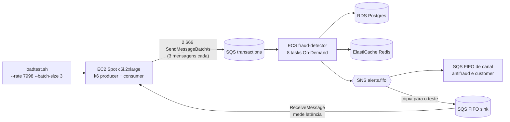

# Teste de carga na AWS: 8.000 TPS (tentativa com 8 tasks)

> Status: **executado em 14/10/2026 e reprovado em C6** (p99 de serviço de 555 ms contra o limite de 500 ms). Todos os outros critérios (C1 a C5, C7 a C11 e G1) passaram. Este documento registra o **resultado** da tentativa. O procedimento, o perfil de carga e os critérios são os do [teste de 1.000 TPS](teste-de-carga-aws-1000tps.md); o gerador em EC2 está em [teste-de-carga-aws-runner-ec2.md](teste-de-carga-aws-runner-ec2.md); o resumo de todas as execuções fica em [registro-testes-aws.md](registro-testes-aws.md).

## Sumário

1. [Veredito](#1-veredito)
2. [Configuração da execução](#2-configuração-da-execução)
3. [Critérios de aceite](#3-critérios-de-aceite)
4. [Latência](#4-latência)
5. [Recursos](#5-recursos)
6. [Comparação com 3.999 TPS](#6-comparação-com-3999-tps)
7. [O que o resultado mostra](#7-o-que-o-resultado-mostra)
8. [Envio em lotes de 3](#8-envio-em-lotes-de-3)
9. [Ressalvas e pontos em aberto](#9-ressalvas-e-pontos-em-aberto)
10. [Próximo passo](#10-próximo-passo)

---

## 1. Veredito

**REPROVADO por 55 ms no p99.** A execução entregou a taxa pedida, sem descartes, sem erros de envio, sem perda nem duplicação de alertas e com as DLQs vazias. O único critério que falhou foi **C6**: p99 de serviço de **555 ms** (limite de 500 ms). O p95 de 260 ms passou.

| Pergunta do teste | Resposta |
|---|---|
| O gerador entregou ~8.000 TPS? | Sim: 2.768.331 de 2.768.310 eventos planejados, 0 descartados |
| Alguma perda ou duplicata? | Não: 27.828 de 27.828 alertas recebidos, 0 duplicados |
| O alerta ficou em até 500 ms no p99? | **Não**: p99 de 555 ms (serviço) e 589 ms (e2e) |
| A fila acumulou? | Não: idade da mensagem mais antiga em 0 s (máx. de 921 mensagens visíveis) |
| Algum componente saturou? | O ECS chegou a 72,9% de CPU, perto do limite de 75%; o RDS ficou em 22,9% e o gerador em 45,1% |

A aplicação continua correta a ~8.000 TPS com 8 tasks; o que se perde é margem de latência na cauda.

---

## 2. Configuração da execução

| Item | Valor |
|---|---|
| Data (UTC) | 2026-10-14, execução de 00:33:19 a 00:41:13 |
| Janela de medição (steady) | 00:34:49 a 00:39:49 (5 min) |
| Perfil | `lean` |
| Aplicação | imagem `6d61ae3-dirty20261012204531` |
| Serviço ECS | 8 tasks Fargate On-Demand de 1 vCPU (toda a cota de 8 vCPU) |
| Gerador | 1 instância EC2 Spot `c6i.2xlarge` (8 vCPU), k6 `a35fa0343085` |
| Envio | `SendMessageBatch` em lotes de 3 (ver [seção 8](#8-envio-em-lotes-de-3)) |
| Carga | 90 s de aquecimento, **7.998 TPS** por 300 s, 60 s de drain |
| Taxa de alertas | 1% |
| Relatório | `load/k6/results/20261014T003319Z-aws-main-c74e6ca9*` |

A taxa foi de **7.998 TPS, e não 8.000**, porque com lotes de 3 o `RATE` precisa ser múltiplo de 3 (`BATCH_SIZE`). A diferença é de 0,025%.

O teste foi a opção "exploratória" combinada com o dono do projeto: a cota de Fargate On-Demand continuava em 8 vCPU (pedido de 16 aberto desde 10/10/2026), então só cabiam 8 tasks. Para isso, o `service_min_count` do `loadtest.tfvars` foi elevado de 6 para 8 durante a execução.

---

## 3. Critérios de aceite

| # | Critério | Limite | Medido | Status |
|---|---|---|---|---|
| C1 | Taxa de envio efetiva | ≥ 99% do planejado e 0 descartadas | 2.768.331 de 2.768.310 (100,0%), 0 descartadas | ok |
| C2 | Erros de envio | < 0,1% | 0,000% | ok |
| C3 | Alertas recebidos ÷ esperados | = 100% | 27.828 de 27.828 | ok |
| C4 | Alertas duplicados | = 0 | 0 | ok |
| C5 | Latência de serviço p95 | < 500 ms | 260 ms | ok |
| **C6** | **Latência de serviço p99** | **< 500 ms** | **555 ms** | **FALHOU** |
| C7 | Idade da mensagem mais antiga em `transactions` | < 5 s; ≈ 0 ao fim do drain | máx. 0 s; fim 0 s | ok |
| C8 | Mensagens nas DLQs | 0 | máx. 0 (3 filas) | ok |
| C9 | CPU média do ECS | < 75% | 72,9% | ok |
| C10 | CPU média do RDS | < 60% | 22,9% | ok |
| C11 | Tasks paradas durante a execução | 0 | 0 | ok |
| G1 | CPU média do gerador na janela steady | < 80% | 45,1% (máx. 46,6%) | ok |

O k6 saiu com **exit 99** (threshold de latência violado), coerente com o C6; o `loadtest.sh` registrou o comando SSM como `Failed` por esse motivo.

---

## 4. Latência

Medida na fase steady.

| Métrica | p50 | p95 | p99 | máx. |
|---|---|---|---|---|
| Serviço (`ingestedAt` → `publishedAt`) | 51 ms | 260 ms | **555 ms** | 1.194 ms |
| e2e (k6) | 83 ms | 293 ms | 589,3 ms | 1.220 ms |
| Envio ao SQS (gerador, **por lote de 3**) | 6,2 ms | 13,2 ms | 58,0 ms | 295,6 ms |

- A cauda é o que degrada: o p50 subiu de 34 para 51 ms, mas o p99 foi de 159 para 555 ms (3,5×) entre 3.999 e 7.998 TPS.
- A diferença entre e2e e serviço (~30 a 35 ms) é a mesma dos degraus anteriores, então o trecho SNS → sink não se deteriorou.
- A latência de envio ao SQS é por chamada de lote e **não é comparável** com a dos testes de 1.000 e 4.000 TPS.

---

## 5. Recursos

Média e máximo na janela steady.

| Recurso | Média | Máx. |
|---|---|---|
| ECS CPU (%) | 72,9 | 73,5 |
| ECS memória (%) | 4,7 | 4,9 |
| RDS CPU (%) | 22,9 | 26,2 |
| RDS conexões | 46,8 | 51,0 |
| RDS latência de escrita (ms) | 0,9 | 1,0 |
| SQS `transactions`: idade da mais antiga (s) | 0,0 | 0,0 |
| SQS `transactions`: mensagens visíveis | 362,6 | 921,0 |
| Gerador k6 (EC2): CPU (%) | 45,1 | 46,6 |

Contagens de CloudWatch na janela steady: SQS `transactions` com 2.399.316 enviadas e 2.399.261 apagadas; SNS `alerts.fifo` com 24.188 publicadas e 0 falhas de entrega.

---

## 6. Comparação com 3.999 TPS

| Métrica | 3.999 TPS (13/10, batch 3) | 7.998 TPS (14/10, batch 3) | Variação |
|---|---|---|---|
| Tasks ECS | 6 | 8 | 1,33× |
| TPS por task | ~667 | ~1.000 | 1,5× |
| Serviço p50 | 34 ms | 51 ms | +50% |
| Serviço p95 / p99 | 89 ms / 159 ms | 260 ms / 555 ms | 2,9× / 3,5× |
| e2e p99 | 200 ms | 589 ms | 2,9× |
| CPU do ECS | 47,4% | 72,9% | 1,54× |
| CPU do RDS | 17,9% | 22,9% | 1,28× |
| Conexões no RDS (média) | 23,8 | 46,8 | 2× |
| Mensagens visíveis (média) | 21 | 363 | 17× |
| CPU do gerador | 40,6% (`c6i.xlarge`) | 45,1% (`c6i.2xlarge`) | |
| Alertas recebidos / esperados | 13.906 / 13.906 | 27.828 / 27.828 | 0 perdas |
| Duplicados | 0 | 0 | |

Com o dobro da carga e 1,33× as tasks, o RDS ainda ficou em um quarto da CPU; o que cresceu de forma desproporcional foi a cauda de latência e a fila (visíveis), junto com a CPU do ECS.

---

## 7. O que o resultado mostra

1. **O gargalo observado é a CPU do ECS, não o banco.** O ECS foi a 72,9% (limite de 75%) enquanto o RDS ficou em 22,9% e escreveu a 0,9 ms. Esta é uma **leitura a partir das métricas**, não um perfil por componente: não foi isolado o que consome CPU dentro das tasks.
2. **A correção se mantém.** 0 perdas, 0 duplicados, fila sem acúmulo e DLQs vazias a ~8.000 TPS.
3. **O gerador não limita mais.** Com lotes de 3, uma instância `c6i.2xlarge` ficou em 45,1% de CPU a 7.998 TPS, bem abaixo do G1 (80%), sem precisar de shards.
4. **A margem acabou.** Com 8 tasks em ~1.000 TPS cada, o C9 passou por 2 pontos percentuais e a cauda já estoura o C6. Os degraus anteriores operavam em cerca de 50% de CPU.
5. **A cota de 8 vCPU é o limite do teste.** Com 8 tasks ocupando todos os vCPU, não há espaço para tasks extras nem para o rolling deploy durante a execução.

---

## 8. Envio em lotes de 3

Este degrau (e o de 3.999 TPS de 13/10) usa `SendMessageBatch` com 3 mensagens por chamada, opção nova do k6 (`BATCH_SIZE`, `--batch-size` no `loadtest.sh`).

- As mensagens entram na fila **individualmente**; o consumer (`MaxNumberOfMessages: 10`) não percebe a diferença.
- `occurredAt` (base da latência e2e) é carimbado logo antes do envio, então não inclui a espera do lote.
- O resultado de `SendMessageBatch` é contado **por entrada** (`Failed[]`), para que `events_sent`, `alerts_expected` e `send_errors` fechem com o que realmente entrou na fila.
- Efeito medido no gerador: a CPU caiu de 58,3% (4.000 TPS, envio individual, `c6i.2xlarge`) para 40,6% (3.999 TPS, lote de 3, `c6i.xlarge`); a latência de serviço ficou equivalente (p99 de 174 e 159 ms).
- **Limitação:** o padrão de chegada em rajadas de 3 difere do envio individual do produtor real, e a métrica de envio ao SQS passou a ser por lote. Não foi medido o efeito do batch isolado em 8.000 TPS, então não se pode afirmar que ele não contribuiu para a cauda de latência.

---

## 9. Ressalvas e pontos em aberto

- **Uma execução só.** No 1.000 TPS o p99 variou de 122 para 242 ms entre rodadas; a variação deste degrau é desconhecida, e 555 ms contra 500 ms é uma margem estreita para concluir o limite.
- **Sem comparação controlada de batch.** Não houve execução a ~8.000 TPS com envio individual, então o efeito do lote na cauda não foi separado.
- **Imagem `-dirty`** (`6d61ae3-dirty...`), sem rastreabilidade a um commit limpo, como nos degraus anteriores.
- **Dashboard sem `pipeline.metrics`.** A imagem em execução não emite essas métricas; a execução usou `--allow-no-metrics`, então o painel de latência da aplicação não tem dados desta janela. As latências acima vêm do k6 e do campo `latencyMs` dos alertas.
- **Contagens de CloudWatch não fecham com o k6** em ~13% (2,40 milhões de enviadas contra ~2,77 milhões do k6), o mesmo desalinhamento de recorte de 1 minuto já visto em 4.000 TPS. Não foi reconciliado.
- **Sem registro de custo** e com as seções "Observações" e "Próximo passo" do relatório gerado em branco.
- **8 tasks e cota cheia.** O resultado não representa a capacidade com mais tasks; a estimativa abaixo é linear, **não medida**.
- **Não foi o teste de 1 h do RNF-01.** A janela estável é de 5 minutos.

---

## 10. Próximo passo

Repetir o degrau com mais tasks assim que a cota de Fargate On-Demand for ampliada (pedido de 16 vCPU aberto; vale pedir um valor maior para cobrir também a rajada de 25k). As projeções abaixo são **estimativas lineares a partir de 8 tasks a 72,9%**, não medições:

| Item | Estimativa para 7.998 TPS |
|---|---|
| Tasks ECS (1 vCPU) | 12 → ~49% de CPU; 10 → ~58% |
| CPU do RDS | ~23% (a carga não muda) |
| Gerador | 1 instância `c6i.2xlarge` (~45%) |

Critérios para a repetição: p99 de serviço < 500 ms com margem, CPU do ECS próxima de 50% e pelo menos duas rodadas para medir a variação. Se houver capacidade, vale uma rodada com envio individual para separar o efeito do batch.

Achados A12 e A13 no [registro](registro-testes-aws.md#achados).
