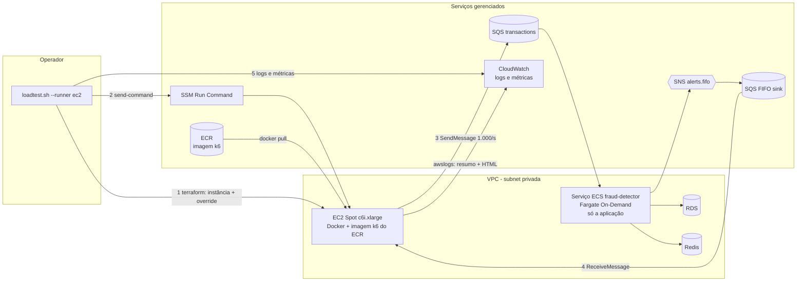
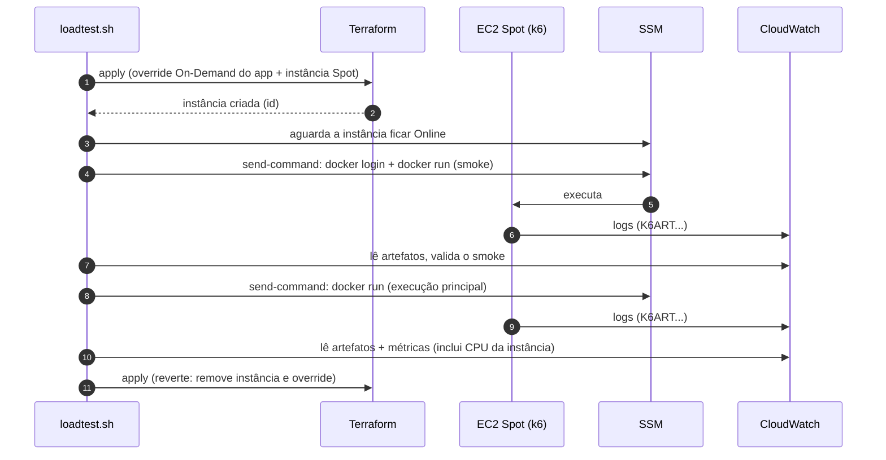

# Teste de carga na AWS: gerador k6 em EC2 Spot

> Status: **fase 1 validada (1.000 TPS em EC2 Spot `c6i.xlarge`) e 4.000 TPS aprovado com uma única instância `c6i.2xlarge` (13/10/2026)**. Os shards (fase 2) e o degrau de 8.000 TPS (fase 3) seguem como plano e dependem de cotas. Complementa [teste-de-carga-aws-1000tps.md](teste-de-carga-aws-1000tps.md), que define critérios, perfil de carga e avaliação.

## Sumário

1. [Por que sair do Fargate para o k6](#1-por-que-sair-do-fargate-para-o-k6)
2. [Dimensionamento (o que as medições mostram)](#2-dimensionamento-o-que-as-medições-mostram)
3. [Arquitetura](#3-arquitetura)
4. [Fases](#4-fases)
5. [Mudanças por componente](#5-mudanças-por-componente)
6. [Cotas](#6-cotas)
7. [Custo](#7-custo)
8. [Riscos](#8-riscos)
9. [Validação da fase 1 (1.000 TPS)](#9-validação-da-fase-1-1000-tps)
10. [Decisões](#10-decisões)

---

## 1. Por que sair do Fargate para o k6

| Problema observado | Efeito |
|---|---|
| O k6 em 2 vCPU de Fargate saturou a ~1.420 TPS (teste de 2.000 TPS: 1.059.206 enviados, 115.443 iterações descartadas) | Teste inválido (C1) |
| A cota de Fargate On-Demand é de 8 vCPU e é **dividida** entre app e gerador | 6 tasks do app + 4 vCPU de k6 estoura a cota |
| Task Fargate só aceita tamanhos fixos (1, 2, 4, 8, 16 vCPU) | Sem meio-termo; 8.000 TPS exigiriam várias tasks |
| Gerador em Fargate On-Demand | ~US$ 0,20/h para 4 vCPU, contra ~US$ 0,05/h em EC2 Spot |

Objetivo: o **Fargate fica dedicado ao app**; o k6 roda em instâncias EC2 Spot criadas e destruídas a cada rodada. As cotas de EC2 (On-Demand e Spot) são separadas das do Fargate.

---

## 2. Dimensionamento (o que as medições mostram)

Medido na AWS, perfil `lean`, app com 3 tasks de 1 vCPU:

| TPS | CPU média do ECS | vCPU do app | Gerador (2 vCPU Fargate) |
|---|---|---|---|
| 1.000 | 26% | ~0,8 | ok |
| ~1.420 | 41% | ~1,2 | saturado (CPU do k6) |

- **k6:** ~710 TPS por vCPU (envio individual, assinatura SigV4).
- **App:** ~0,8 a 0,9 vCPU por 1.000 TPS. A 60% de CPU (alvo do autoscaling): ~1,4 vCPU por 1.000 TPS.

| Degrau | k6 (vCPU) | App no alvo de 60% | Gerador EC2 Spot |
|---|---|---|---|
| 1.000 TPS | ~1,5 (usar 4 por margem) | ~1,5 vCPU | 1 × `c6i.xlarge` (4 vCPU) |
| 2.000 TPS | ~3 | ~3 vCPU | 1 × `c6i.xlarge` |
| 4.000 TPS | ~6 | ~6 vCPU | 1 × `c6i.2xlarge` (8 vCPU) |
| 8.000 TPS | ~11 a 12 | ~11 a 12 vCPU | 2 × `c6i.4xlarge` (32 vCPU) |

Extrapolação linear: cada degrau precisa ser validado por teste. Para 8.000 TPS, 8 vCPU de Fargate no app ficam a ~85% de CPU (C9 falha); recomenda-se 16 vCPU com `service_max_count` ~12.

---

## 3. Arquitetura

Fluxo de uma rodada:

---

## 4. Fases

| Fase | Entrega | Validação | Status |
|---|---|---|---|
| **1** | 1 instância EC2 Spot + `--runner ec2` (padrão) + CPU do gerador no relatório | Smoke e **1.000 TPS** | validada |
| 2 | Shards do k6 (várias instâncias, 1 consumidor) e soma dos resumos | 4.000 TPS | plano |
| 3 | Mais cota (Fargate e Spot), `service_max_count` ~12, instâncias maiores | 8.000 TPS | plano |

---

## 5. Mudanças por componente

### Fase 1 (esta implementação)

| Componente | Mudança |
|---|---|
| `envs/production/loadtest_ec2.tf` (novo) | Role e instance profile (SSM + ECR + logs + as permissões atuais do gerador), instância EC2 Spot de requisição única (`instance_interruption_behavior = terminate`), AMI Amazon Linux 2023 via SSM parameter, subnet privada, `sg-loadtest`, IMDSv2, monitoring detalhado, user-data que instala o Docker |
| `variables.tf` | `enable_loadtest_ec2`, `loadtest_instance_type` (vazio = `c6i.xlarge` ou `c7g.xlarge` conforme `cpu_architecture`), `loadtest_use_spot` |
| `outputs.tf` | `loadtest_instance_ids` |
| `loadtest.sh` | `--runner ec2\|fargate` (padrão `ec2`), `--on-demand` (desliga o Spot), `--instance-type`. No modo EC2: espera o SSM, executa o `docker run` via `send-command`, lê o código de saída, usa o log driver `awslogs` no mesmo log group do Fargate |
| `loadtest_report.py` | `--generator-instance`: CPU média e máxima do gerador na janela, com aviso se passar de ~80% (gerador saturado) |
| `load/k6/fraud-latency.js` | Sem mudança |
| Fargate | O task definition do k6 permanece, atrás de `--runner fargate`, como fallback |

### Fase 2 (plano)
- `SHARD`, `SHARDS` e `ROLE` (`producer` ou `consumer`) no k6; `transactionId` com o shard; um consumidor único lê o sink.
- `loadtest_report.py` soma os resumos dos produtores.

### Fase 3 (plano)
- Cotas e capacidade do app; `service_max_count` e o tamanho das instâncias por degrau (seção 2).

---

## 6. Cotas

| Cota | Hoje | Necessário |
|---|---|---|
| Fargate On-Demand vCPU | 8 (pedido de 16 em aberto, `CASE_OPENED`) | 16 para 8.000 TPS com folga |
| EC2 Running On-Demand Standard vCPU | 8 | só no fallback `--on-demand` |
| EC2 All Standard Spot Instance Requests vCPU | 8 | 8 (fase 2) e 32 (fase 3) |

A fase 1 cabe nas cotas atuais: 4 vCPU de Spot para o k6 e o app em Fargate.

---

## 7. Custo

| Item | Valor aproximado |
|---|---|
| `c6i.xlarge` Spot (4 vCPU) | ~US$ 0,06/h; ~US$ 0,03 por rodada de 30 min |
| `c6i.xlarge` On-Demand | ~US$ 0,17/h |
| k6 em Fargate de 4 vCPU (hoje) | ~US$ 0,20/h |
| SQS a 1.000 TPS (rodada de 5 min) | ~US$ 0,4 a 1 |

O custo do gerador é desprezível; o de SQS e do ambiente ligado dominam (ver [teste-de-carga-aws-1000tps.md](teste-de-carga-aws-1000tps.md), seção 9).

---

## 8. Riscos

| Risco | Mitigação |
|---|---|
| Spot sem capacidade ou reclamado | A rodada é repetida; `--on-demand` como fallback |
| Primeiro uso de Spot na conta: falta a service-linked role `AWSServiceRoleForEC2Spot` | Perfil administrador a cria no primeiro uso; senão `aws iam create-service-linked-role --aws-service-name spot.amazonaws.com` |
| Docker ou SSM agent demoram a ficar prontos | O script espera o status Online no SSM e testa `docker info` antes de rodar |
| Imagem de arquitetura diferente da instância | A instância usa a mesma arquitetura da imagem (`cpu_architecture`) |
| Falha no meio deixa instância viva | Instância Spot de requisição única criada pelo Terraform: a reversão do script e o `terraform destroy` removem; o `loadtest.sh` revisa no `trap` |

---

## 9. Validação da fase 1 (1.000 TPS)

Mesmos critérios C1 a C11 do plano principal, com os tempos padrão (90 s de aquecimento, 5 min de medição, 1 min de drain), mais:

| # | Critério | Limite |
|---|---|---|
| G1 | CPU média do gerador (EC2) na janela steady | < 80% |
| G2 | Nenhuma interrupção Spot | 0 |
| G3 | Resultados (`.txt`, `.json`, `.html`) remontados dos logs | presentes |

Se passar, a fase 2 (shards) e o teste de 4.000 TPS seguem.

---

## 10. Decisões

- **Decidido:** k6 em EC2 **Spot** como padrão; Fargate só para o app; `--runner fargate` mantido como fallback por ora.
- **Decidido:** a instância é criada e destruída a cada rodada (não fica fixa).
- **Em aberto:** remover o runner Fargate depois da fase 2; pedir a cota de Spot de 32 vCPU junto com a do Fargate (fase 3).
