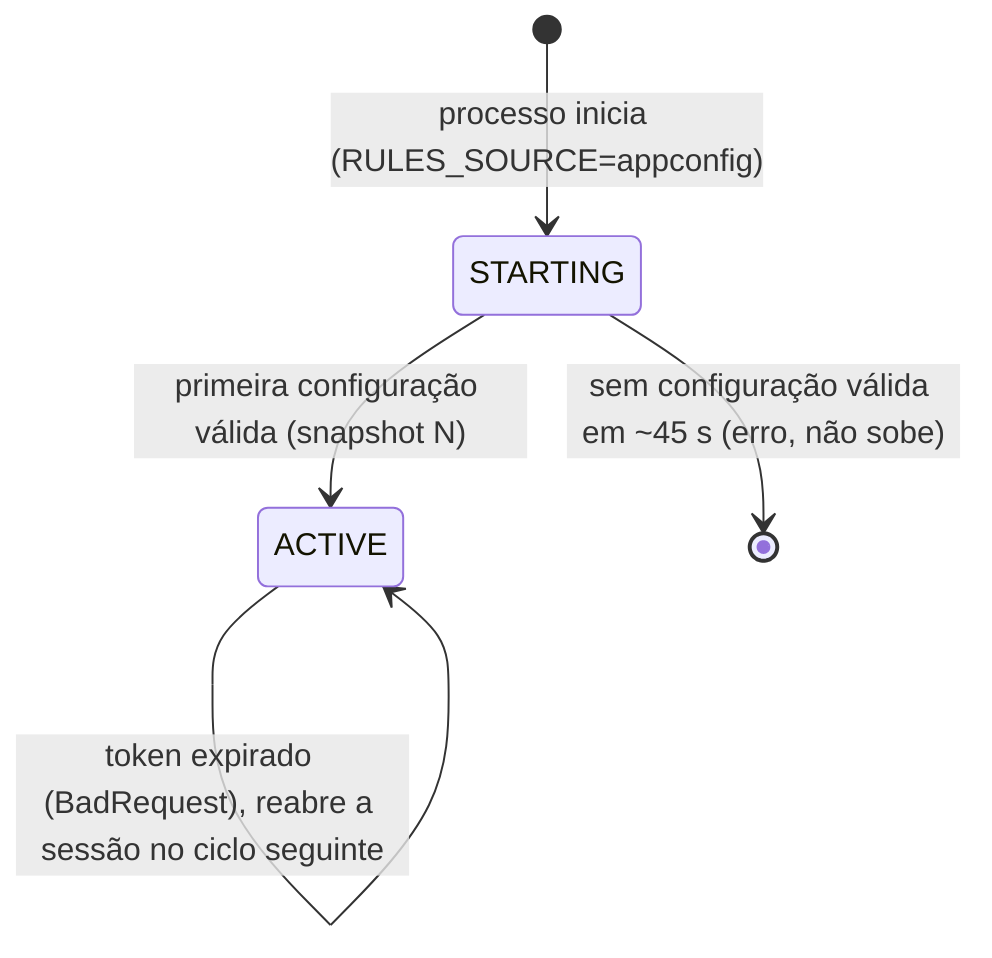

# Modelo de dados (Fase 1): Regras dinâmicas via AppConfig

Esta feature **não cria tabelas nem migrações**: o estado das regras vive em memória na instância e a fonte da verdade é o AppConfig. As entidades abaixo descrevem o que existe em memória e o que trafega.

## Entidades

### RulesDocument (documento de regras, publicado pelo operador)

Conteúdo JSON publicado como versão hospedada do AppConfig. Contrato: [contracts/rules-document.v1.schema.json](contracts/rules-document.v1.schema.json).

| Campo | Tipo | Regra |
|-------|------|-------|
| `rules` | lista de `Rule v1` | Obrigatória, ao menos 1 item e ao menos 1 com `mode = ACTIVE` |
| `revision` | inteiro | **Opcional**; só vale na fonte por arquivo (dev). Em produção é ignorado (D-03) |

Regras de validade (aplicadas pelo script de publicação e pela instância, com o mesmo código `validateRulesDocument`; o perfil do AppConfig confere só a estrutura, em draft 4):

1. Cada item valida contra `rule.v1.schema.json`.
2. `ruleId` único no documento.
3. Nenhuma regra `WINDOWED` nem com `window` (fase 1).
4. A expressão compila no `DeclarativeRuleEngine` (sintaxe, custo, raízes permitidas).
5. Ao menos uma regra `ACTIVE`.

### Revision (revisão)

| Campo | Tipo | Origem |
|-------|------|--------|
| `id` | inteiro positivo | `Version-Label` do AppConfig (carimbo UTC `YYYYMMDDHHMMSS`); em modo arquivo, o campo `revision` do documento |

Imutável. Uma revisão rejeitada nunca vira `RuleSnapshot`.

### RuleSnapshot (conjunto ativo, em memória)

Já existe (`src/rules/static-rule.repository.ts`): `{ revision: number, rules: readonly Rule[] }`, congelado com `Object.freeze`. Mantém-se a forma, para o `ProcessTransactionService` não mudar.

- Substituído **por inteiro** por uma única atribuição de referência (troca atômica, FR-008). Uma avaliação lê a referência **uma vez** no início (`loadActiveSnapshot`) e usa só esse objeto até o fim.
- Nunca é editado parcialmente.

### RuleSourceState (estado da fonte, em memória, por instância)

| Campo | Tipo | Uso |
|-------|------|-----|
| `activeRevision` | inteiro | Métrica `RulesActiveRevision` |
| `lastSuccessfulRefreshAt` | instante | Idade do refresh (`RulesLastRefreshAgeSeconds`) |
| `refreshFailures` | contador | `RulesRefreshFailures` |
| `sessionToken` | texto opaco | Token da sessão do AppConfig; **nunca logado** |
| `phase` | `STARTING` / `ACTIVE` | `STARTING` até a primeira configuração válida; nesse estado o serviço ainda não aceita tráfego |

`lastSuccessfulRefreshAt` é atualizado em toda consulta bem-sucedida, inclusive a que devolve "sem mudança" (corpo vazio): a idade mede a saúde da consulta, não a data da última mudança.

## Transições de estado

## Métricas (nomes estáveis)

| Métrica `/metrics` | Métrica do CloudWatch (`FraudDetector/Rules`, via filtro de métrica sobre a linha `rules.metrics`) | Tipo |
|---|---|---|
| `rules_active_revision` | `RulesActiveRevision` | gauge |
| `rules_last_refresh_age_seconds` | `RulesLastRefreshAgeSeconds` | gauge |
| `rules_refresh_failures_total` | `RulesRefreshFailures` | contador (delta por minuto na linha de log) |
| `alerts_total` (existente) | `AlertsCreated` | contador (delta por minuto na linha de log) |

Sem rótulos de alta cardinalidade nem identificadores de tarefa nas séries do CloudWatch; a divergência entre instâncias sai de `MAX − MIN` do mesmo gauge.

## Logs

Eventos: `rules.refresh.ok` (revisão antiga e nova), `rules.refresh.unchanged` (nível debug), `rules.refresh.failed` (motivo categórico), `rules.document.rejected` (apenas `ruleId` e regra violada), `rules.startup.failed`. Nunca registrar o conteúdo do documento, expressões ou parâmetros das regras além do `ruleId`, nem o token de sessão (FR-015).
