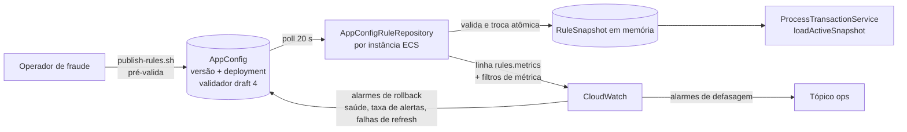

# Implementation Plan: Regras de Decisão Dinâmicas via AppConfig

**Branch**: `002-appconfig-dynamic-rules` | **Date**: 2026-10-10 | **Spec**: [spec.md](spec.md)

**Input**: Feature specification from `/specs/002-appconfig-dynamic-rules/spec.md`

## Summary

Hoje as regras são lidas de `config/rules.json` uma única vez, na criação do `RulesModule`. Esta feature troca a fonte de produção pelo **AWS AppConfig**: cada instância consulta o serviço a cada ~20 s, valida o documento (mesmo código do validador do perfil) e **troca o snapshot inteiro de uma vez**; o caminho crítico continua lendo só a memória.

- **Cadastro, alteração e rollback** acontecem por `scripts/rules/publish-rules.sh` (versão hospedada com rótulo numérico + deployment), com estratégia gradual curta por padrão e imediata para urgências.
- **Validação em três camadas, sem Lambda:** pré-validação completa no `publish-rules.sh` (mesma função `validateRulesDocument` da instância), validador JSON Schema **draft 4** estrutural no perfil do AppConfig (o AppConfig só valida o draft 4, e o `rule.v1` usa o 2020-12) e revalidação na instância.
- **Falhas:** na partida, *retry* com *backoff* por ~45 s e, se não obtiver regras válidas, o processo não sobe; em runtime, mantém a última versão válida.
- **Observabilidade:** métricas de revisão ativa, idade do refresh e falhas, escritas como uma linha JSON `rules.metrics` no stdout e transformadas em métricas do CloudWatch por filtros de métrica (sem nova dependência de métricas), com alarmes de defasagem, rollout travado e taxa de alertas; os alarmes de saúde, de taxa de alertas e de **falhas de refresh** alimentam o **rollback automático** do AppConfig, que reverte sozinho um documento que as instâncias rejeitem.
- **Rede e segurança:** SDK direto (sem o *sidecar* AppConfig Agent, descartado em research D-01); no perfil `full` o endpoint de VPC `appconfigdata` é adicionado; IAM de menor privilégio para instâncias e operadores.
- **Dev/local:** `RULES_SOURCE=file` preserva o comportamento atual.

Detalhes: [research.md](research.md) · [data-model.md](data-model.md) · [contracts/](contracts/) · [quickstart.md](quickstart.md)



## Technical Context

**Language/Version**: TypeScript 5.7 sobre Node.js ≥ 22

**Primary Dependencies**: NestJS 11, `ajv` + `ajv-formats` (já dependências), `@aws-sdk/client-appconfigdata` (nova; justificada em research D-01); `ajv-draft-04` como devDependency, só para o teste de equivalência dos schemas (research D-04)

**Storage**: nenhum novo. Estado das regras em memória; fonte da verdade no AppConfig. Sem migrações.

**Testing**: Jest (unitário com cliente AppConfig falso; integração da troca atômica), `npm run contracts:validate` (inclui `rules-document.v1` e o teste de equivalência 2020-12 ↔ draft 4), `terraform validate`/`plan` para a infraestrutura. Verificação real contra o AppConfig no [quickstart](quickstart.md).

**Target Platform**: Linux (contêiner Docker) no ECS Fargate; AWS AppConfig e CloudWatch. Localmente, fonte por arquivo.

**Project Type**: Serviço backend único (worker de filas + endpoints de saúde), com infraestrutura Terraform e scripts de operação.

**Performance Goals**: 8.000 TPS sustentados (picos de 25 mil); alerta ≤ 500 ms. Impacto da feature no caminho crítico: **nulo**, porque a avaliação lê uma referência em memória e nenhuma chamada de rede acontece nele.

**Constraints**:
- O caminho crítico nunca chama o AppConfig (FR-009).
- Troca atômica por substituição de referência; leitura única do snapshot por avaliação (FR-008).
- Sem fallback para o arquivo embutido em produção (FR-011).
- Logs sem conteúdo de regras além do `ruleId`, sem token de sessão (FR-015).
- Sem nova dependência de I/O no processo para métricas (linha JSON no stdout + filtros de métrica).

**Scale/Scope**: poucas dezenas de regras por documento (limite de contrato: 200); dezenas de tarefas ECS, cada uma com 1 sessão e ~3 consultas por minuto; 1 aplicação, 1 ambiente (`production`), 1 perfil.

## Constitution Check

*GATE: avaliado antes da Fase 0 e reavaliado após a Fase 1.*

| Princípio | Avaliação | Observação |
|-----------|-----------|------------|
| I. Arquitetura modular NestJS | ✅ | A mudança fica no módulo `rules` (repositório por fonte, extração de `validateRulesDocument`) e no módulo `observability` (publicador de métricas por log). A abstração `RuleConfigClient` tem duas implementações reais (AppConfig e arquivo), atendendo ao critério da constituição |
| II. Contratos primeiro | ✅ | `rule.v1` não muda; o envelope `RulesDocument v1` é um contrato novo, versionado, em [contracts/](contracts/) (referência 2020-12 e espelho estrutural em draft 4), a ser levado a `docs/contratos/` e ao `contracts:validate`, com teste de equivalência, antes da implementação |
| III. Idempotência | ✅ | Não se aplica ao fluxo de alertas; a troca de snapshot não altera `dedupe_key` nem a avaliação |
| IV. Resiliência | ✅ | Timeout e *retry* com *backoff* no cliente do AppConfig; última versão válida em falha; fail-fast na partida; falhas cobertas por testes (cliente falso) |
| V. Desempenho | ✅ | Sem I/O no caminho crítico; declarado no plano; verificação por teste de carga com publicação no meio da execução ([quickstart §4](quickstart.md)) |
| VI. Regras extensíveis sem redeploy (v2.1.0) | ✅ | Implementa o princípio: fonte gerenciada, validação prévia, troca atômica, fail-fast na partida, última versão válida em execução, sem fallback embutido em produção |
| VII. Segurança, privacidade e observabilidade | ✅ | Menor privilégio para instâncias (só leitura do perfil) e para operadores (política dedicada); TLS e SigV4 na API do AWS, sem endpoint local sem autenticação (sem Agent); endpoint de VPC no perfil `full`; sem conteúdo de regras nem token em logs; métricas e alarmes novos |
| Restrições técnicas | ✅ | Nova tecnologia (AppConfig e SDK de dados) justificada em research D-01 e no ADR-03; sem mudança de esquema de banco |

**Resultado:** sem violações. Uma complexidade adicional é justificada abaixo.

**Reavaliação pós-design:** mantida. O ajuste da clarificação Q3 (rótulo numérico no lugar do "número de versão") não toca nenhum princípio.

## Project Structure

### Documentation (this feature)

```text
specs/002-appconfig-dynamic-rules/
├── plan.md
├── research.md
├── data-model.md
├── quickstart.md
├── contracts/
│   ├── appconfig-rules-source.md
│   └── rules-document.v1.schema.json
└── tasks.md             # gerado por /speckit-tasks
```

### Source Code (repository root)

```text
src/
├── rules/
│   ├── rules.module.ts                  # escolhe a fonte por RULES_SOURCE; fail-fast na partida
│   ├── rules-document.validator.ts      # NOVO: validateRulesDocument (puro; usado na instância e no script de publicação)
│   ├── rules-config.loader.ts           # passa a usar o validador; mantém a leitura do arquivo
│   ├── rule-source.ts                   # NOVO: RuleConfigClient + tokens
│   ├── appconfig-rule.repository.ts     # NOVO: sessão, poll, troca atômica, estado e métricas
│   ├── appconfig-rule.client.ts         # NOVO: implementação sobre @aws-sdk/client-appconfigdata
│   └── static-rule.repository.ts        # mantém a mesma interface (fonte por arquivo)
├── observability/
│   └── metrics-log.publisher.ts         # NOVO: escreve a linha rules.metrics a cada 60 s
├── config/config.module.ts              # novas variáveis RULES_SOURCE, APPCONFIG_*, RULES_*
└── transactions/process-transaction.service.ts   # sem mudança (contrato de loadActiveSnapshot preservado)

infra/terraform/envs/production/
├── appconfig.tf                         # NOVO: aplicação, ambiente, perfil, estratégias, monitores
├── iam.tf                               # leitura do AppConfig na role app; política/papel rules-operator (kms:Decrypt só se o perfil usar CMK)
├── network.tf                           # endpoint de VPC appconfigdata no perfil full
├── monitoring.tf                        # alarmes de defasagem, divergência, taxa de alertas e falhas de refresh
├── ecs.tf                               # variáveis RULES_SOURCE e APPCONFIG_*
└── variables.tf                         # rules_operator_principals, tolerância de divergência

scripts/rules/
└── publish-rules.sh                     # NOVO: pré-valida, publica, reverte (--rollback) e para (--stop); usa validateRulesDocument

docs/contratos/rules-document.v1.schema.json         # NOVO (a partir de contracts/), + exemplos e validate-contracts.mjs
docs/contratos/rules-document.v1.draft4.schema.json  # NOVO: espelho estrutural em draft 4 (validador do perfil) + teste de equivalência
docs/adr/ADR-03-motor-de-regras.md             # já atualizado

test/ (e *.spec.ts ao lado do código)
├── src/rules/appconfig-rule.repository.spec.ts
├── src/rules/rules-document.validator.spec.ts
├── src/observability/metrics-log.publisher.spec.ts
└── test/integration/rules-atomic-swap.int-spec.ts
```

**Structure Decision:** projeto único existente; a feature fica no módulo `rules`, mais um emissor em `observability`, mais Terraform e um script de operação que reaproveita o mesmo validador (executado com `ts-node`).

## Complexity Tracking

| Violação / complexidade | Por que é necessária | Alternativa mais simples rejeitada porque |
|-------------------------|----------------------|--------------------------------------------|
| Segundo schema (draft 4 estrutural) para o perfil do AppConfig | O AppConfig só valida o draft 4, e o `rule.v1` é 2020-12; FR-005 pede validação na publicação, inclusive pelo console | Usar o `rule.v1` direto não é aceito pelo AppConfig; um validador Lambda foi descartado (research D-04) por custo desproporcional. O risco de divergência dos dois schemas é coberto por teste de equivalência no `contracts:validate` |
| Publicador de métricas por log próprio + filtros de métrica | Hoje nenhuma métrica customizada chega ao CloudWatch, e os alarmes de defasagem e de taxa de alertas dependem delas | `PutMetricData` no processo adicionaria I/O externo a proteger; um *sidecar* adicionaria um contêiner |
| Interface `RuleConfigClient` | Permite testar sem AppConfig real (LocalStack gratuito não o emula) e reaproveitar o repositório na fonte por arquivo | Chamar o SDK direto no repositório tornaria os testes dependentes de AWS |

## Ajustes decorrentes do plano

- **Spec:** Clarification Q3 e trechos correlatos passam a falar em "rótulo de versão numérico definido na publicação" (achado A2). Aplicado.
- **ADR-03:** acrescentar, quando a implementação começar, as decisões do rótulo de versão (A2), das três camadas de validação sem Lambda (A1, D-04) e do descarte do AppConfig Agent (D-01).
- **Rede:** no perfil `full`, adicionar `appconfigdata` aos endpoints de VPC; sem isso as tarefas não sobem (A11, D-12).
- **A confirmar antes de implementar:** prefixo da ação IAM (`appconfig:`), nome do serviço de endpoint e necessidade de `kms:Decrypt` com CMK (A12). Ver pendências no [research.md](research.md).
- **Agente:** `.specify/scripts/bash/` não tem script de atualização de contexto do agente; nada a atualizar.
